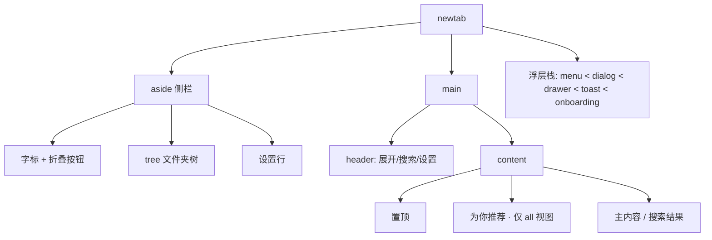

# Markoob for Firefox — 交互与体验规格

> **⚠ v1 存档**：v2.0 的交互以 `newtab/newtab.js` 实际实现为准。主要差异：无首次引导；内容区为单视图（全部/置顶/最近浏览/文件夹/搜索），不再多分区平铺；设置收敛为一页对话框；移除隐藏、布局/密度/字号/宽度配置与排序方向。文案 key 清单 `docs/feature-inventory.md` 已更新到 v2。本文其余章节保留作历史参考。

> 体验：ux-designer · 视觉裁决：`docs/design-spec.md` · 令牌：`shared/tokens.css` · 工程契约：`docs/impl-brief.md` · 文案 key：`docs/feature-inventory.md`
>
> 本文件是**交互行为的唯一裁决源**：状态机、焦点、按键、菜单项序、校验、反馈、断点行为。视觉数值一律引用 `design-spec.md` 的小节号，不在此重复造表。
>
> 术语约定：
> - **视图（view）**：`all` 全部书签 / `folder` 当前文件夹 / `search` 搜索态（搜索态是 `all` 或 `folder` 上的**模式**，不是第三个视图）。
> - **区块（section）**：置顶 `pinned` / 为你推荐 `rec` / 主内容 `content` / 搜索结果 `results`。
> - **条目（item）**：`card`（书签卡片 / 文件夹卡片）或 `compact`（单行）。同一条目在两种样式下交互完全一致，仅方向键几何不同。
> - 文案一律写成 `key`（中文），例如 `allBookmarks`（全部书签）。
> - 交叉引用的消歧规则：`§` 指向**本文件**；`design-spec §x` 指向视觉规范。本文件自己的 §6 只到 §6.6、§7 无子节，因此正文里未加前缀的 `§5.1 / §5.2 / §6.7 – §6.15 / §7.1 – §7.3` **一律指 `design-spec.md`**。

---

## 0. 阅读指引、设计原则与冲突裁决

### 0.0 阅读指引（任务书 14 项 → 本文章节）

| 任务书要求 | 本文件位置 |
|---|---|
| 1 设计原则（3 条可判定） | **§0.1** |
| 2 信息架构与导航模型 | §1；三个核心裁决见 **§1.6** |
| 3 状态矩阵 | §2（组件 × 状态）；**§2.1（用户状态 × 焦点，S1–S10 共 10 态）** |
| 4 首次使用 | §3-A、§3-M、**§3-N** |
| 5 核心流程 | §3-A … §3-P |
| 6 键盘模型 | §4.1 – §4.7 |
| 7 无障碍 | §11.3、**§11.5（role/aria 表）**、**§11.6（链接 vs 按钮）**、**§11.7（播报分级）** |
| 8 响应式 | §11.1、**§11.8（760 与低高度）** |
| 9 文案规范 | **§15** |
| 10 边界情况 | **§16** |
| 11 组件状态清单 | **§17** |
| 12 验收清单 | §12.1（20 条）、**§12.3（追加 12 条）** |
| 13 Firefox 差异 | **§18**（另见 §3-L、§3-J、§3-F 的校验规则） |
| 14 待拍板 | **§13 已全部拍板**：2 项取 A（§13.1 / §13.2），另 5 项见 §13.3；无遗留待决项 |

### 0.1 设计原则（3 条，可判定）

| # | 原则 | 判据（不满足即退回） |
|---|---|---|
| **P1** | **首屏不滚动就能走完主路径。** 1440×900、默认设置下，搜索框 + 当前视图第一行条目必须全部在首屏内；用户不需要滚动即可完成「打开一个书签」或「进入一个文件夹」。 | 1440×900 截图里内容区第一行条目的底边可见。任何新增区块若把它推出首屏，必须改成折叠态、挪到设置里，或砍掉。 |
| **P2** | **一次点击到达，且每个可逆操作都留退路。** 每个可见书签条目到「打开」= 1 次点击；置顶、隐藏、删除三个会改变用户数据模型的操作，必须各自带一条不需要重新找到原位置的退路（取消置顶入口 / 设置里的恢复列表 / 8s 撤销）。 | 逐项检查：新加的任何"操作菜单项"若会改变 `pinned`/`hidden`/书签树，却既无撤销也无恢复入口，不合入。 |
| **P3** | **没有鼠标也能做完核心任务。** 打开、搜索、进入/返回文件夹、右键菜单全部能力、增删改、置顶、隐藏、移动书签（经编辑对话框）、改设置，每条都要能在 §4 查到按键路径。 | 对照 §4 表格逐行验证；§8 末列出的 3 个已知缺口必须在 §13 有明确处置，不得悄悄存在。 |

**由三条原则推出的硬性取舍**（用于日常判断，不单独成条）：

1. 信息展示型区块（推荐、提示）在垂直空间紧张时**先让位**给"我的内容"（P1）。
2. 二次确认只出现在**不可撤销或跨文件夹批量**的场景（删除、一次开多个窗口）；置顶/隐藏不确认，用退路兜底（P2）。
3. 任何 hover-only 控件都必须有菜单等价入口；置顶区的「取消置顶」是唯一允许的 hover 控件，因此菜单里必须有同一项（P3，见 §6.6）。
4. 新状态优先用「已有组件 + 文案」表达，不新增组件（P1 的副作用：新组件会推高首屏）。

### 0.2 与既有文档的冲突裁决

以下 3 处文档间不一致，本文件按右侧结论执行；工程按本表实现即可，无需再回问。

| # | 冲突 | 出处 A | 出处 B | 裁决 |
|---|---|---|---|---|
| 1 | 骨架屏显示阈值 | `design-spec.md` v0.3 §6.13 **C1：120ms 延迟 + 最短停留 400ms** | `impl-brief.md` §6「≥120ms 才显示」（只写了延迟，缺"最短停留"） | **120ms 延迟 + 最短停留 400ms**，>8s 转错误态。视觉方已确认 v0.1 的单一 600ms 阈值是错的：裸用 120ms 会让本地瞬时读取闪一下骨架，裸用 600ms 又让用户先看 0.6 秒空白 —— 两者同时成立只能拆成「延迟 + 最短停留」。`impl-brief` 需补"最短停留 400ms"。 |
| 2 | 侧栏自动折叠宽度 | `design-spec.md` §5「< 1080 折叠」 | `impl-brief.md` §6「< 1000」 | **1080**（v0.3 已确认）：1080 折起时内容区 4 列（245），保留侧栏则掉到 3 列（253）——4 列节奏更稳。 |
| 3 | 侧栏拖拽范围 | `tokens.css` `--sidebar-w-min/max` = 196 / 320 | `impl-brief.md` §6「200–360」 | **196–320**（令牌是唯一来源）。理由已修正为**比例**而非列数：1280 窗口配 360 侧栏仍是 4 列，但 360 占窗口 28%，侧栏又全是短标签，再宽只是把左侧变成空白并挤压正文。**原先「会掉到 3 列」的论证算错了，勿再引用。**正确的列数算式留在此处备查，避免下一个人重算出第三种说法：`(1280 − 360 − 64 + 12) / (190 + 12) = 4.29 → 4 列`，卡宽 `(856 − 3×12) / 4 = 205`（`auto-fill` min 190、gap 12、内容区 pad 32×2）。 |

### 0.3 需视觉确认清单（结论已给，但会产生新的视觉元素）

以下 9 项已由 design-architect **全部签字**（v0.2–v0.3，索引见 `design-spec.md` §10），**无新增视觉元件**（全部是既有规格的位移、字号调整或容器复用）。本表保留为施工对照；与视觉文档不一致时以 design-spec 为准。

| # | 事项 | ux 的结论 | 为什么不能由 ux 决定 |
|---|---|---|---|
| V1 | 区块标题**行尾**「↩ 全部书签」返回 | **准，改 3 处**：13/500 / `--accent`；图标 14 + gap 6；视觉高 20 但**点击区高 28**（`padding:4px 6px; margin:-4px 0 -4px -6px`）；位置在 1px 结构线右端，**不紧跟计数** | design-spec §6.3 |
| V2 | 区块底部「还有 N 项」（`showMore`）追加按钮 | **准，改 4 处**（v0.3）：13/500 `--accent`（同 V1）；视觉高 **28**（原稿 20 太薄，点击区不足）；`margin-left: -8` 让文字与卡片左缘对齐；距区块末行 **12**。**禁**分隔线 / 边框 / 底色 / 通栏 —— 它是区块最后一行内容，不是区块终点。位置：内容区与置顶区**同一处**（区块最后一行之下、左对齐）。**并且这是本规格唯一新增的文案 key**：`showMore` = 「还有 {{n}} 项」/「{{n}} more」，`feature-inventory.md` 缺失，需补进 `shared/i18n.js` | design-spec §6.3；文案 key 的补齐需与 `feature-inventory.md` 的维护方对齐 |
| V3 | 搜索框结果计数「{{n}} 项」 | **准，去掉胶囊外壳**：纯文字 12/400 `--text-tertiary`。带边框的胶囊语义是「可按」，计数不可按（不是字距问题，是容器选错了） | design-spec §6.2 |
| V4 | 置顶卡常态预留右侧空间 | **准**：`.card-body` 在既有 12 内边距之外**追加 20**（总右内缩 32、净空 8）；按钮 `right:8 top:8`；必须在 `:focus-within` 下出现且**可 Tab 到达**；出现/消失只改 `opacity`，不产生位移 | design-spec §6.7 |
| V5 | 搜索命中片段 `<mark>` | **准**：`--accent-soft` 底 + `--text` + `padding:0 1px` + `--r-xs`；**不加下划线、不加粗**（加粗会改字重与行长，1 行截断会跳）；**只用于标题，域名不标** | design-spec §6.4 |
| V6 | 侧栏行键盘焦点 `outline-offset: -2px` | **准（显式例外）**：必须配 `border-radius: 4px`（否则四角切方）；**仅限侧栏树行** | design-spec §7.1 |
| V7 | 760 单列、`max-height: 600px` 隐藏推荐 | **准，且采纳 ux 版本**：≤760 单列**限宽左对齐**（card 320 / compact 480，不拉满）、内容区左右 **20**；760–1079 仍 32；高度 <600 隐藏推荐、置顶最多 1 行（超出走 V2），**隐藏后不留空槽、不留标题** | design-spec §5.1 |
| V8 | 设置抽屉窄窗宽度 | **准**：`min(380px, 100vw)`；≤480 全宽时**去掉左缘 1px 线** | design-spec §6.11 |
| V9 | 演示模式徽标位置 | **原方案被驳回**，改放**顶栏右侧动作簇最左**：6px 圆点（`--spine-2`）+ 8 + `DEMO`（11/500 `--text-tertiary`，0.04em），与动作簇 gap 12。理由：输入框尾槽已有两个状态在轮转，塞第三个会让 40px 行反复改宽 | design-spec §6.2 |

---

## 1. 信息架构与导航

### 1.1 屏幕 / 区域 / 浮层清单

| # | 名称 | 类型 | 层级令牌 | 出现条件 | 说明 |
|---|---|---|---|---|---|
| 1 | 新标签页（`newtab`） | 根页面 | `--z-base` | 每次打开新标签页 | 唯一的全屏界面 |
| 2 | 侧栏（`aside`） | 区域 | `--z-base` | 窗口 ≥1080 或手动展开 | 宽 `--sidebar-w`，可拖拽 196–320 |
| 3 | 顶栏（`header`） | 区域 | `--z-sticky` | 常驻 | 高 `--topbar-h` 56，含搜索框；折叠态时左侧出现展开按钮 |
| 4 | 内容区（`main`） | 区域 | `--z-base` | 常驻 | 区块垂直顺序：`pinned` → `rec` → `content`/`results` |
| 5 | 侧栏调宽手柄 | 控件 | `--z-resize-handle` | 常驻（侧栏展开时） | 宽 4，Hover/拖拽显 `--line-strong` 竖线 |
| 6 | 搜索态（`mode=search`） | 模式 | — | 输入框 trim 后非空 | 不改路由，只切换内容区内容 |
| 7 | 右键菜单（`menu`） | 浮层 | `--z-menu` 100 | 右键 / Shift+F10 | 书签 / 文件夹 / 空白 / 历史推荐项 四种内容 |
| 8 | 对话框（`dialog`） | 浮层 | `--z-dialog` 210（遮罩 200） | 见 §9 | 添加书签 / 编辑书签 / 新建文件夹 / 重命名文件夹 / 删除确认 / 二维码 |
| 9 | 设置抽屉（`drawer`） | 浮层 | `--z-drawer` 220 | 侧栏底部「设置」行 / `,` / 折叠态顶栏设置按钮 | 宽 380 右侧滑入 |
| 10 | Toast | 浮层 | `--z-toast` 300 | 见 §10 | 单槽位，最多 1 条可见 |
| 11 | 首次引导（`onboarding`） | 浮层 | `--z-onboarding` 400 | `settings.onboardingDone !== true` 或 `#onboarding` | 全屏遮罩 + 480 卡 |
| 12 | 内容态：空 / 无结果 / 错误 / 骨架 | 内联状态 | — | 见 §2 | 不新建浮层，占用内容区 |
| 13 | 工具栏弹窗（`popup`） | 独立页面 | — | 点击扩展图标 | 宽 340，见 §3-J |
| 14 | 演示模式徽标 | 顶栏元素 | `--z-base` | `MK.api.isDemo` | 顶栏右侧动作簇**最左**：6px 圆点（`--spine-2`）+ `DEMO`（11/500），不放在输入框尾槽 |

### 1.2 层级关系

```
newtab (body)
├── aside 侧栏
│   ├── head（字标 15/600 + 16 图标 · 折叠按钮 28×28）
│   ├── tree [role=tree]（可滚动）
│   │   ├── 全部书签（无脊，网格图标）
│   │   └── 工具栏 / 书签菜单 / 未分类 / 移动端（rootKey，有脊）
│   │       └── …用户子文件夹（每级 +14 缩进）
│   └── foot（设置行，30 高，常驻）
├── main 列
│   ├── header 顶栏 56
│   │   ├── 展开按钮 32×32（仅侧栏折叠时）
│   │   ├── 搜索框 40（+ 清除按钮 / 结果计数：纯文字）
│   │   └── 设置按钮 28×28（仅侧栏折叠时；避免与侧栏底部双入口）
│   └── content 内容区
│       ├── section pinned 置顶（全局，任何视图都显示；空则整块隐藏）
│       ├── section rec 为你推荐（仅 all 视图，设置开启时；空则整块隐藏）
│       └── section content / results
│           ├── folder 视图：区块标题(16/600)+返回按钮 → 子文件夹卡片 → 书签
│           └── all 视图：4 张根夹卡片 → 全部书签扁平列表
└── overlays（互斥栈，见 §4.5）
    menu(100) < dialog(210) < drawer(220) < toast(300) < onboarding(400)
```

Mermaid（同上，便于渲染）：



### 1.3 进入 / 退出路径与焦点

路由：hash 只承载两件事 —— `#onboarding`（强制打开引导）与 `#/f/<folderId>`（深链进入文件夹，供 QA 与「新标签页复现」）。其余视图状态保存在内存 + `settings.lastFolderId`。

| 动作 | 从 | 到 | 进入后焦点落点 | 返回时焦点恢复 |
|---|---|---|---|---|
| 点击侧栏文件夹行 / 树内 Enter | 任意视图 | `folder(id)` | 该文件夹的区块标题（`tabindex="-1"`，读屏读出文件夹名 + 计数） | 触发它的侧栏行（行始终存在） |
| 点击子文件夹卡片 / 卡上 Enter | `folder` 或 `all` | `folder(child)` | 子文件夹区块标题 | 触发它的文件夹卡片（回到父视图后存在） |
| 点击「↩ 全部书签」 | `folder` | `all` | `all` 视图的 4 张根夹卡片中的第 1 张；若不存在则搜索框 | — |
| 点击侧栏「全部书签」行 | 任意 | `all` | 搜索框 | — |
| 输入搜索词 | 任意 | 同视图 + `mode=search` | 焦点留在搜索框（不移动） | 清空搜索 → 焦点留搜索框，内容区回到原视图并恢复 `scrollY` |
| 关闭搜索（二次 Esc / 点清除后再 Esc） | `search` | 原视图 | 内容区 `content` 区块第一项；无项则搜索框 | — |
| 打开设置抽屉 | 任意 | +`drawer` | 抽屉容器（`role=dialog`，读出标题 `settings`） | 触发它的按钮（侧栏设置行 / 顶栏设置按钮） |
| 关闭抽屉 | — | 回原视图 | — | 同上 |
| 打开右键菜单 | 任意 | +`menu` | 若无键盘触发，焦点**不动**（菜单自己接管方向键）；键盘触发时焦点移入菜单第 1 项 | 关闭后回到被右键的条目；该条目已被删除/移走 → 回到同区块第一项，区块消失则搜索框 |
| 打开对话框 | 任意 | +`dialog` | 见 §9 每类的「默认焦点」 | 打开它的按钮；来自菜单 → 回到被右键条目 |
| 引导完成/跳过 | — | 回 `all` | 搜索框（显示焦点环） | — |

**焦点恢复实现约束**：
- 每次打开浮层前记录 `returnFocus = document.activeElement`；关闭时若 `returnFocus.isConnected` 则 `.focus()`，否则按上表降级。
- 焦点恢复必须与浮层关闭动画同步：`--dur-slow` 结束后再 focus，避免浏览器滚动到将消失的元素。若 `data-motion="off"` 则立即 focus。
- 视图切换后 `scrollY` 写入 `ui.scroll[viewKey]`，返回时恢复；`viewKey` = `all` 或 `folder:<id>` 或 `search`。

### 1.4 文件夹树展开/折叠规则

| 规则 | 定义 |
|---|---|
| 初始展开层级 | 首次打开：展开到**第 2 级**（4 个根夹 = 第 1 级默认展开，其直接子文件夹为第 2 级、默认**折叠**）。即首屏可见「全部书签 / 工具栏 / 书签菜单 / 未分类 / 移动端」。 |
| 例外 | `settings.showLastFolder` 开启且存在 `lastFolderId` → 只展开该文件夹的祖先链，其余根夹仍展开（不折叠）。 |
| 展开状态存储 | `ui.expanded: [folderId]`；折叠父级**不清除**子级的展开记忆，重新展开时恢复。 |
| 进入某文件夹 | 自动展开其**所有祖先**（不含自身），并把当前行滚入可视区（`block:'nearest'`）。 |
| 层级深度 | 不限制；缩进每级 +14。第 5 级起缩进仍 +14（不做上限压缩，靠省略号保证名称可读）。 |
| 当前项 | 只有一项处于选中态（`aria-current="page"` + `--surface-active` + 色脊 3px 100%）。 |
| 计数为 0 的文件夹 | 侧栏计数**隐藏**（不显示 "0"，`design-spec` §6.1）；`settings.hideEmptyFolders` 开启时整行不渲染。 |
| 空树 | 侧栏只渲染「全部书签」行 + 设置行；不显示 4 个空根夹（避免 4 行 0 项噪音）。 |
| 自动滚动 | 挂载完成后一次、每次 view 变更、每次展开后，调用 `当前行.scrollIntoView({block:'nearest'})`；不改变页面滚动。 |

### 1.5 内容区三个区块的结构规则

| 区块 | 出现条件 | 内容与顺序 | 上限与溢出 | 交互差异 |
|---|---|---|---|---|
| **置顶 `pinned`** | 全局：`all` 与 `folder` 视图**都显示**；`pinned` 为空 → 整块隐藏（含标题，不留空白标题行） | 书签与文件夹**混排**，顺序 = `pinned` 数组顺序（用户拖拽决定，新建置顶追加到末尾）；同一网格、同一卡片规格（§6.7） | 最多显示 **12** 项；超过时在第 12 张卡片**下方**（区块最后一行之下、左对齐）出现 `showMore`（还有 {{n}} 项）追加控件，n = 未显示的置顶数，规格同内容区（§0.3 V2：13/500、高 28、`margin-left:-8`、距末行 12、禁分隔线/边框/通栏）。点击后置顶区渲染全部置顶项，按钮消失（不做「收起」，用户可用搜索或滚动） | 唯一允许 hover 出按钮的区块（取消置顶，§6.6）；支持整卡拖拽排序 |
| **为你推荐 `rec`** | **只在 `all` 视图**显示；`settings.recommendations === false` 或结果为空 → 整块隐藏（不伪造推荐） | **固定 `compact` 单行样式**，不跟随 `settings.style`；最多 **6** 条（`design-spec` §5.2：≤3 列 × 2 行，容器 ≤ `--rec-max` 900） | 硬上限 6，无溢出按钮（推荐不是清单，追加没有意义） | 历史来源条目在域名后加 `fromHistory`（来自历史记录）12/400 `--text-tertiary` 小标记；**不可拖拽**（起拖 → toast `dndNotForRecommended`，每会话 1 次）；菜单为精简版（§6.2.1） |
| **主内容 `content`** | 常驻 | `all` 视图：4 张根夹卡（工具栏 / 书签菜单 / 未分类 / 移动端）→ 全部书签扁平列表（树遍历顺序：工具栏 → 书签菜单 → 未分类 → 移动端，深度优先）。`folder` 视图：区块标题（16/600）+ 返回按钮 → 子文件夹卡 → 书签 | 单区块 600 条 + 底部 `showMore`（还有 {{n}} 项）按钮追加（§2「5000 条书签规则」） | 拖拽移动/排序；空白处右键为空白菜单 |

**`folder` 视图的返回按钮（新元素，但复用现有规格）**：位置 = 区块标题**行尾**（1px 结构线右端，**不紧跟计数**）；内容 = 14px 左箭头图标 + `allBookmarks`（全部书签），图标与文字 gap 6；规格 = **13/500 `--accent`，视觉高 20 / 点击区高 28**（`padding:4px 6px; margin:-4px 0 -4px -6px`），悬停下划线；`aria-label` = 「返回全部书签」。不做面包屑（产品决策 5）。**注：原稿的「复用 §6.7 次级按钮 12/500、高 20、位置在标签右侧」已按 V1 签字作废，勿再引用。**

**根夹卡片**：与文件夹卡完全同规格（§6.6），副行显示递归书签数（`{{n}} 项`）或 `emptyFolder`；**不显示**下拉展开（卡片只负责进入）。

### 1.6 三个核心裁决（必须显式回答，不允许"看情况"）

#### Q1：点击文件夹是「进入」还是「展开」？

**结论：点是「进入」；「展开」是独立的命中区 + 独立的按键。两者永不共用一次点击。**

| 位置 | 命中区 | 行为 |
|---|---|---|
| 侧栏行的 **名称 / 图标 / 色脊 / 计数** | 行内剩余宽度（≥150×30） | **进入**该文件夹（切视图，`aria-current="page"` 跟随） |
| 侧栏行的 **chevron（折叠箭头）** | 视觉 14×14，命中区扩到 28×28（§7.3 最小目标） | **只展开/折叠**，视图不变 |
| 内容区 **文件夹卡片**（整卡） | 68 高整卡 | **进入**该文件夹 |
| 键盘 | — | `Enter` = 进入；`→` = 展开（已展开则进首个子行）；`←` = 折叠（已折叠则回父行）；`Space` = 只展开/折叠 |

理由：合并成一个点击会让「我只想看看里面有什么」变成一次视图跳转 + 一次返回；反过来（点箭头也进文件夹）会让「点了一下没进去」成为第二高频的挫败。分离后 1 次点击 = 1 个确定结果，与 Finder / VSCode 的肌肉记忆一致。**已知风险**：chevron 与文件夹名相邻，误点率最高 → §12.2 坑 1 给出实现约束（独立 handler + `stopPropagation`）。

#### Q2：「全部书签」视图到底显示什么？

**结论：4 张系统根文件夹卡片 + 全部书签的扁平列表（按当前排序，首次渲染 600 条，之后「还有 N 项」追加）。**

| 元素 | 出现 | 细节 |
|---|---|---|
| 4 张系统根夹卡片 | ✅ | 工具栏 / 书签菜单 / 未分类 / 移动端，顺序固定；副行 = **递归书签数**（§5「计数规则」）；`hideEmptyFolders` 开启时隐藏递归数为 0 的 |
| 全部书签扁平列表 | ✅ | 不受文件夹层级影响，= 全库书签按当前排序的线性列表；单次渲染 600 + 追加（§2「5000 条书签规则」） |
| 深层文件夹卡片 | ❌ | 深挖是侧栏与根夹卡片的职责；在首页平铺所有文件夹会让"首页"变成树的可视化，失去跳板意义 |
| 总书签数为 0 | — | 不显示 4 张 0 项卡，直接显示 `emptyState` + `addBookmark` |

**为什么不选"只显示根文件夹卡片"**：那会让「全部书签」这个名字名不副实（用户点它期待看到"全部"），且用户想"扫一眼所有书签"时没有入口——搜索要求他已经知道要找什么。**代价**：首屏在置顶 + 推荐之后才开始列表，5000 条时需要追加。缓解：① 单次 600 条上限（性能可控）；② 搜索是跨全库的最短路径（§7）；③ 置顶/推荐任一为空时整块隐藏，首屏自动上移（§2）。

#### Q3：置顶与推荐在文件夹视图里是否还显示？

| 视图 | 置顶 | 为你推荐 | 理由 |
|---|---|---|---|
| `all` 全部书签 | ✅ | ✅ | 首页是跳板，需要跨文件夹出口 |
| `folder` 任意文件夹 | ✅ | ❌ | 置顶是**快捷方式层**，不属于任何文件夹的内容层，所以进到哪都该在；推荐是"猜你想去哪"，进入具体文件夹后上下文已经收窄，再给猜测会与用户当前意图打架，并吃掉 1 行首屏（P1） |
| `search` 搜索态 | ❌ | ❌ | 搜索要"压缩到唯一目标"；保留置顶会让结果计数（`{{n}} 项`）与可见条目数不一致，且重复项让人怀疑搜索没生效 |

**重复项处理（置顶在文件夹视图与内容区重复时）**：

1. 内容区**必须完整**：置顶项若是当前文件夹的子项，内容区仍显示它——不能因为"上面已经有了"就从文件夹里删一条，那会让用户以为书签丢了。
2. 置顶区**不计入**内容区计数（区块标题的 `{{n}} 项` 只算内容区条目）。
3. 同一屏幕出现两次是被接受的（P2 只约束"打开路径"，不约束快捷方式层）。推荐区的排除口径（本文件为准，覆盖 `impl-brief` §5 的「排除当前文件夹已显示项」）：
   - **排除** `pinned` 中的项（否则用户会在同一屏看到"置顶"与"推荐"两条一模一样的东西）；
   - **排除** `hidden` 中的项与被 `hideEmptyFolders` 隐藏的项；
   - **不排除**已在 `all` 视图内容列表中出现的书签 —— 推荐是"快捷方式层"，`all` 的内容列表是"全库层"，两层同屏重复是设计意图（也是 §1.6 Q2 结论 A 的已知代价），不做任何去重或视觉标记。

---

## 2. 状态矩阵

`offline` 列：本产品**零网络依赖**（`prd.md` §7），断网时除「在网页中搜索」与打开网页本身交给浏览器处理外，其余行为与在线完全一致 —— 不做离线提示、不做离线降级 UI。

| 界面 / 区域 | loading | empty | error | search | demo | offline |
|---|---|---|---|---|---|---|
| 侧栏树 | >120ms 未返回才显示 5 行骨架（高 30、宽 60–80% 错落，§6.13），骨架最短停留 400ms；≤120ms 直接渲染 | 只显示「全部书签」+ 设置行 | 只显示「全部书签」+ 设置行；树区不显示错误（错误由内容区承担） | 不变（不随搜索过滤，避免用户失去位置感） | 用 `demo-data.js` 的树（含 3 级嵌套、1 个空夹）；行尾不改样式 | 不变 |
| 置顶区 | 隐藏（无骨架） | 整块隐藏（含标题） | 隐藏 | **隐藏**（见 §7） | 3 置顶项（书签+文件夹混排），可拖拽排序（写 demo localStorage） | 不变 |
| 为你推荐 | 隐藏 | 整块隐藏（不伪造推荐） | 隐藏 | 隐藏 | 6 条：4 书签 + 2 条 `fromHistory`（带「来自历史记录」标记） | 不变（历史来自本地库） |
| 全部书签视图 | >120ms 未返回才显示骨架（8 张卡，68 高；最短停留 400ms） | 4 根夹卡 + `emptyState`（这里还没有书签）+ `emptyStateHint` + ghost「`addBookmark`」 | 错误态（§6.14）：`errorTitle` + `errorHint` + primary「`retry`」 | 结果列表替换 `content`，根夹卡片不显示 | 根夹卡 4 张（其中「移动端」为空夹 → 副行 `emptyFolder`）+ 28 条书签 | 不变 |
| 文件夹视图 | 同骨架 | 见下方「文件夹为空」行 | 同内容区错误态 | 结果列表替换 `content` | 用户文件夹 3 个、书签 12 条 | 不变 |
| 文件夹为空（递归书签数 0） | — | 子文件夹卡片（若有）保留 + `emptyState` + `emptyStateHint` + ghost「`addBookmark`」 | — | — | 同左 | 不变 |
| 搜索无结果 | 输入后 ≤120ms 显示上一轮结果（不显示骨架，本地过滤无需 loading） | — | 历史查询失败：静默省略「历史记录」组，其余正常 | `noResults`（没有找到「q」）+ `noResultsHint` + ghost「`searchWeb`」（q 长度 ≥2 时） | demo 有固定数据集，可用 `?state=search` 预填一个无结果的词以便走查 | 不变 |
| 权限被拒（`browser.bookmarks` 抛错） | — | — | 内容区错误态；**搜索框 `disabled`**（`aria-disabled` + `aria-describedby` 指向 `errorHint`）；侧栏只剩「全部书签」；唯一动作「`retry`」 | 不适用 | 不会出现（demo 层不抛错） | 不变 |
| 单条书签读取异常 | — | — | **不报错**，静默跳过该条（§6.14） | 同左 | — | — |
| 超长标题（≥120 字符）/ 空标题 | 不影响加载 | 不影响空态判断（空标题不算空） | 不影响错误态 | 参与搜索与高亮（按全文匹配，展示按省略） | 同左 | 不变 —— 具体规则见下方「超长标题规则」表 |
| 5000 条书签 | 骨架 + 分块渲染（见下） | — | — | 结果上限 200 + 追加 | — | — |

**超长标题规则**

| 场景 | 规则 |
|---|---|
| 标题 ≥120 字符 | 视觉 1 行 + 省略号（§3「标题最多 1 行」）；DOM 保留全文；`title` 属性 = 全文（浏览器原生 tooltip）；读屏读全文。卡片高度不变（68 固定，2 倍字号时 `min-height` 撑开）。 |
| 标题为空 | 回退顺序：① `hostname`（去掉 `www.`）→ ② 完整 URL（1 行省略）。两者都为空时显示 `urlLabel`（链接）二字。侧栏文件夹名为空 → 回退到 `folderLabel`（文件夹）。 |
| 域名超长（如长 IDN） | 1 行 + 省略号；`title` = 全文。 |
| 侧栏文件夹名超长 | 1 行 + 省略号，计数仍右对齐固定；`title` = 全文。 |

**5000 条书签规则**

| 规则 | 值 |
|---|---|
| 溢出按钮（俗称「还有 N 项」） | **可见文字与 `aria-label` 同一个 key：`showMore` = 「还有 {{n}} 项」**（n = 尚未渲染的剩余数）。位置：**内容区与置顶区同一处** —— 区块**最后一行之下、左对齐**（内容区与置顶区不得用两种位置，否则同一控件在不同区块长得不一样）。视觉：13/500 `--accent`、高 **28**、`margin-left: -8`（让文字与卡片左缘对齐）、距区块末行 12；**禁**分隔线 / 边框 / 底色 / 通栏，悬停下划线。**注意：`showMore` 是 `feature-inventory.md` 里缺失的 key**（`design-spec` §6.7 已在用它，但清单里只有 `items`「{{n}} 项」），工程需要在 `shared/i18n.js` 补这一条，中文「还有 {{n}} 项」/ 英文「{{n}} more」。这是本规格唯一新增的文案 key，见 §0.3 V2。 |
| 单区块首次渲染上限 | **600** 条；超出时在该区块底部渲染该按钮，每次点击追加 600，直到结束（按钮随之消失） |
| 搜索结果上限 | 首次 **200**，同样用 `showMore` 按钮每次追加 200 |
| 侧栏文件夹节点 | **不做上限**，全量渲染。理由：树是 ARIA `tree`，插入「加载更多」会破坏 `aria-setsize` / 方向键连续性；实测 800 个文件夹 ≈ 4800 个 DOM 节点，可接受。仅当单个文件夹的直接子项 > 200 时，默认折叠并把其行计数显示为真实递归数（用户点开即展开）。 |
| 渲染预算 | 单次渲染（600 条）< 400ms；超出说明实现有问题（须检查是否每次重建整棵树） |
| 不做虚拟滚动 | 理由：会和「拖拽插入线」「区块内几何方向键」两者冲突，收益不抵复杂度。用上限 + 追加兜住。 |
| 搜索 | 过滤全量（内存数组线性扫描，5000 条 < 8ms），只截断渲染 |

**排序与筛选对状态的影响**

| 条件 | 表现 |
|---|---|
| `sortKey !== 'default'` | 内容按该排序渲染；区块标题**不显示任何排序指示**（排序入口只在设置抽屉，`design-spec` §6.3 的标题结构里没有排序控件）；拖拽仅允许「移动到文件夹」，禁止「插入排序」（§8） |
| `settings.showHidden` 开启 | 被隐藏的书签/文件夹正常渲染，**不加任何视觉差异**（`design-spec` §8 禁止新增徽标/标记）；只在设置行文案里说明是「临时」显示 |
| `settings.hideEmptyFolders` 开启 | 递归书签数为 0 的文件夹在侧栏与文件夹卡片中都不渲染 |

### 2.1 用户状态 × 焦点矩阵（S1–S10）

上表是"组件 × 状态"；本表是"用户视角的一次屏"，两表必须同时满足。**焦点列是硬约束**：任何实现若把焦点留在 `body`，视为缺陷（§12.2 坑 3）。

| # | 状态 | 触发 | 用户看到什么 | 可做什么 | 焦点在哪 | 播报（§11.7） |
|---|---|---|---|---|---|---|
| S1 | **加载 0–120ms** | 首帧，`getTree()` 未返回 | 侧栏与内容区**留白**（不画骨架、不放 spinner）；顶栏与搜索框已可用 | 开始打字（结果稍后补齐）；`Esc` 无效 | 搜索框（已聚焦，双环可见 §4.7） | 静默 |
| S2 | **加载 ≥120ms** | 仍未返回 | 侧栏 5 行 + 内容区 8 张 68 高骨架（§10.3），**最短停留 400ms**；形状 = 真组件 | 等；搜索框可输入，但结果为空 | 搜索框 | 静默（骨架 `aria-hidden="true"`，容器 `aria-busy="true"`） |
| S3 | **有数据** | 树读取成功 | 侧栏树 + 置顶（非空时）+ 推荐（`all` 视图且开启时）+ 内容区 | 全部能力 | 搜索框 | 无（首屏不播报） |
| S4 | **空文件夹** | 当前文件夹递归书签数 0 | 子文件夹卡片（若有）保留 + `emptyState` + `emptyStateHint` + ghost「`addBookmark`」 | 添加书签（默认父级 = 该文件夹）；返回；进子夹 | 空状态容器 `tabindex="-1"`（无卡片可聚焦时） | polite：文件夹名 + `emptyFolder` |
| S5 | **全局 0 书签** | 树成功但书签总数 0 | 不显示 4 张 0 项根卡；`emptyState` + `emptyStateHint` + ghost「`addBookmark`」；置顶/推荐隐藏 | 添加书签；`n` | 「`addBookmark`」按钮（页面内唯一可操作项） | polite：`emptyState` |
| S6 | **搜索中** | `q.trim() !== ''` | 结果四组（文件夹 → 书签 → 历史 → 网页搜索）；搜索框右侧计数「{{n}} 项」+ 清除按钮；置顶/推荐**一次性**隐藏 | `↑↓` 移动、`Enter` 打开、`Esc` 清空/退出、清除按钮、继续输入 | 搜索框（除非用 `↓` 进入结果） | polite，随计数元素（`aria-describedby`） |
| S7 | **搜索无结果** | `q` 非空且 0 命中 | `noResults` + `noResultsHint` + （`q` 长度 ≥2）ghost「`searchWeb`」；计数「0 项」；输入框不变红 | 点网页搜索；`Enter` = 网页搜索；改词；`Esc` | 搜索框 | polite：`noResults` |
| S8 | **权限错误** | `browser.bookmarks` 抛权限错 / 8s 超时 | 内容区错误态（`errorTitle` + `errorHint` + primary「`retry`」）；侧栏只剩「全部书签」+ 设置行；**搜索框 `disabled`**（`aria-disabled` + `aria-describedby` → `errorHint`）；置顶/推荐不渲染 | 重试；开设置抽屉；折叠侧栏 | 「`retry`」按钮 | **assertive**：`errorTitle` + `errorHint` |
| S9 | **演示模式** | 无 `browser.bookmarks`（静态预览） | 顶栏**右侧动作簇最左**的徽标（6px 圆点 + `DEMO` 11/500，`title`/`aria-label` 带解释；**不占输入框尾槽**）；数据 = `demo-data.js`；写入落 localStorage | 全部能力（等同 S3） | 搜索框 | polite（页面加载后一次）：「演示模式」 |
| S10 | **读取中刷新** | `bookmarks.onChanged` 重建（debounce 150ms） | **不显示骨架、不清空内容、不动焦点**；>800ms 未完成时搜索框尾部 hint 区显示「正在更新…」（`updatedRunning`；该槽位与结果计数互斥，徽标已移出该槽 — 见 design-spec V9） | 继续操作（若点到已消失的节点 → §16-B8） | 保持现状 | 静默（避免每次书签变动都打断读屏） |

补充约束：

- S2 → S4/S6/S7/S8 之间**不允许**出现"骨架 → 空 → 骨架"的抖动：骨架只在 `treeLoaded === false` 时出现，之后所有刷新走 S10。
- 每个空态/错误态只有**一个**动作（design-spec §6.12）：S4/S5 = 添加书签，S7 = 网页搜索，S8 = 重试。
- S8 下 `Ctrl/Cmd+K` 与 `/` 不生效（搜索框 disabled），这是唯一让全局快捷键失效的状态。

---

## 3. 关键流程

> 每个流程末尾的「✗」是失败分支。所有 toast 文案走 `feature-inventory.md` 的 key。

### A. 首次安装 → 引导 4 步 → 首次新标签页

1. 安装完成，`background.js` 写默认 `settings`（`onboardingDone:false`）。
2. 用户按 Ctrl+T。`<head>` 中 `theme-init.js` **同步**读 localStorage 并写 `<html data-theme>`（防闪白）。
3. 渲染骨架占位容器（不立即显示骨架图形）；同时 `MK.api.getTree()`。
4. 120ms 内返回 → 直接渲染侧栏 + `all` 视图，**全程无骨架**。>120ms → 显示骨架并**最短停留 400ms**（§10.3）。>8s → 内容区错误态（`errorTitle`）。
5. 首屏渲染完成后 **300ms**（避免与骨架同时闪、也避免打断已经开始打字的用户），因 `onboardingDone === false`，挂载引导层（z400，遮罩 `--overlay`；延迟理由见 §3-N）。
6. 引导打开时搜索框**已被聚焦**但被遮罩覆盖 → 焦点移到引导卡容器（`role="dialog" aria-modal="true"`，`tabindex="-1"`，`aria-labelledby` 指向步骤标题）。
7. 步骤 1–4 按 `ob1Title/ob1Desc` … `ob4Title/ob4Desc`；底部进度 `obStep`（"第 n 步，共 4 步"）+ 4 段 24×2 指示线（§6.15）。
8. 点 `obNext` → 步骤 +1；焦点留在容器；`aria-live="polite"` 播报新的 `obStep`。第 1 步时 `obBack` **不渲染**（§3-N：disabled 按钮会留在 Tab 序里且无意义）。
9. 第 4 步主按钮文案变 `obStart`。
10. 点 `obStart` / `obSkip` → 写 `settings.onboardingDone = true` → 关闭引导 → 焦点移回搜索框（显式加 `data-focus-ring="on"`，见 §4.7）。
11. 首次新标签页此时：`pinned` 空（隐藏）、`rec` 空（隐藏，因无 usage/history）、`content` = 4 根夹卡 + 全部书签列表。焦点在搜索框，直接打字即可搜。

- ✗ 步骤 10 的写入失败（`storage.local` 抛错）：仍关闭引导（不让用户卡住），toast `saveFailed`（`what` = `settings`）；下次打开会再出现引导。
- ✗ 引导显示期间 `getTree()` 失败：引导**照常走完**（不阻塞），关闭后内容区是错误态 + `retry`。
- ✗ 用户在引导中点遮罩空白处：**不关闭**（只有 `obSkip`/`obStart` 能结束）。

### B. 找到并打开书签

四种输入方式，行为矩阵：

| 操作 | 目标窗口 | 是否遵循 `openWith` | 说明 |
|---|---|---|---|
| 左键 / 键盘 Enter | `openWith`（`newtab` → 新标签页；`current` → 当前标签页） | 是 | 唯一受设置影响的路径 |
| 中键 / 鼠标滚轮键 | 新标签页（后台） | **否** | 走原生 `<a target="_blank">`，不拦截 |
| Ctrl/Cmd + 左键 | 新标签页（后台） | **否** | 同上，浏览器原生 |
| Ctrl/Cmd + Enter | 新标签页（前台） | **否** | 键盘等价于「新标签页打开」 |
| Shift + Enter | 新窗口 | **否** | 键盘等价于 `openInNewWindow` |
| 隐私窗口 | 只用右键菜单 | — | 见流程 L |

步骤（左键 / Enter）：

1. 焦点在条目上（roving tabindex），或指针悬停。
2. 触发 → 校验 URL 协议（§9.1「协议黑白名单」）。
3. 合法 → 立即执行打开（不等待动画，不显示 loading），并 `recordOpen(url)`（失败静默，不 toast）。
4. 新标签页模式：`browser.tabs.create({url})`（或保留 `<a href>` 让浏览器原生处理，再在 click 里补记录 usage —— 二选一，推荐原生锚点 + `click` 记录，保证中键/Ctrl 可用）。
5. 当前页模式：`preventDefault()` + `browser.tabs.update({url})`。
6. 打开后本页面不保留任何状态变化（不 toast、不置灰）。

- ✗ `javascript:` / `data:` / `vbscript:` → **不导航**，toast `bookmarkletBlocked`（此链接类型无法直接打开），8s 后自动消失。菜单项同理可用（不禁用，见 §6.4 原则）。
- ✗ `file://` → 不导航，`copyText(url)` 复制链接，toast `fileUrlBlocked`。复制也失败 → toast `permissionDenied`（`what` = `copyUrl`）。
- ✗ `browser.tabs.create` 抛错 → toast `permissionDenied`（`what` = `openInNewTab`）。
- ✗ `recordOpen` 失败：静默（不影响打开）。

### C. 搜索

1. 触发：`Ctrl/Cmd+K`、`/`、点击搜索框、新标签页自动聚焦。
2. 输入 → **120ms 防抖** → 计算。`trim().length === 0` → 退出搜索态（内容区回原视图），搜索框恢复快捷键胶囊。
3. 查询规范化：`String(raw).trim().normalize('NFC').toLowerCase()`。
4. 匹配与权重（同分时按「使用频率降序 → 原始顺序升序」排）：

| 字段 | 权重 | 说明 |
|---|---|---|
| 标题前缀命中 | 100 | `title.toLowerCase().startsWith(q)` |
| 标题包含 | 60 | |
| 文件夹名包含 | 50 | 文件夹结果组 |
| 域名前缀命中 | 45 | `hostname.startsWith(q)` |
| 域名包含 | 35 | |
| URL（含路径/参数）包含 | 20 | 只匹配不展示路径 |

> 不做模糊匹配、不做拼音、不做错字纠正 —— 保持「输入即所见」的可预测性。

5. 结果分组顺序（固定）：**文件夹 → 书签 → 历史记录 → 网页搜索**。空组不渲染（不显示空标题）。
6. 搜索框右侧：快捷键胶囊（`⌘K`）换成**纯文字**结果计数 `{{n}} 项`（12/400 `--text-tertiary`，**不加边框与底色**——带边框的胶囊语义是"可按"，计数不可按），同时出现 16px 清除按钮（`clearSearch` 作为 `aria-label`）。
7. 高亮：标题与域名中的命中片段包 `<mark>`（`--accent-soft` 底 + `--text`，不加下划线、不加粗）；**URL 路径命中不高亮**（路径不展示）。
8. 键盘：`↓` 从搜索框进入结果第 1 项；`↑↓` 在结果间移动（线性，不分列）；`Enter` 打开聚焦项，无聚焦项时打开第 1 项；`Esc` 第一次清空查询（焦点留搜索框），第二次退出搜索态并把焦点交给内容区第一项。
9. 搜索时**置顶区与推荐区都隐藏**：搜索是「过滤整个书签库」，若保留置顶/推荐会让「结果计数」与可见条目数不一致，且重复项会让用户怀疑搜索是否生效。
10. 搜索范围 = 全部书签，**不受当前文件夹限制**。当前视图状态保留在内存，退出搜索即恢复（含 `scrollY`）。

- ✗ 无结果（q 长度 ≥2）：`noResults` + `noResultsHint` + ghost 按钮「`searchWeb`」（在网页中搜索「q」，带 14px 外链图标）。点击 → `browser.search.search({query:q})`。
- ✗ 无结果（q 长度 = 1）：同上但**不显示**网页搜索按钮（1 个字符搜网页无意义）。
- ✗ `browser.search.search` 不可用/抛错 → toast `permissionDenied`（`what` = `searchWeb`）+ `copyText(q)`。
- ✗ 历史查询失败 / `settings.showHistoryInSearch === false` → 历史组不出现，无任何错误提示。
- ✗ 历史结果与已有书签重复 URL → 去重，只保留书签组里的那条（历史不得压过用户自己的书签）。

### D. 右键书签（全菜单）

1. 触发：右键条目 / `Shift+F10` / 键盘 `ContextMenu` 键 / 长按（不做长按，仅桌面）。
2. 菜单内容按 §6.2 顺序渲染；`pin/unpin` 与 `hide/unhide` 的文案按当前状态确定。
3. 定位：指针触发 → 光标右下 2px；键盘触发 → 条目左下。溢出翻转见 §6.5。
4. 打开时焦点：键盘触发 → 移入第 1 项（`role="menuitem"`，`tabindex=0`），其余 `tabindex=-1`；指针触发 → 焦点留在原条目（菜单接管方向键），`aria-activedescendant` 指向第 1 项。
5. `↑↓` 移动（跳过分隔符与禁用项），`Home/End` 首末，`Enter`/`Space` 执行，`Esc` 关闭，`Tab` 关闭菜单并把焦点交给下一个区域。
6. 选中一项 → 关闭菜单 → 执行 → 菜单焦点回到条目（若条目仍在）。

- 关键分支：

| 选中项 | 行为 | 失败分支 |
|---|---|---|
| `openInNewTab` / `openInNewWindow` | 见流程 B | toast `permissionDenied` |
| `openInPrivate` | `browser.extension.isAllowedIncognitoAccess()` → true 则 `browser.windows.create({url, incognito:true})` | false 或抛错 → toast `privateBlocked`，**不退化成普通窗口** |
| `qrCode` | 打开二维码对话框（§9.4） | 渲染失败 → toast `saveFailed` |
| `pin` / `unpin` | 更新 `pinned` 数组 → 置顶区即时重排 → toast `bookmarkPinned` / `bookmarkUnpinned` | 写失败 → 回滚 + toast `saveFailed` |
| `hide` / `unhide` | 更新 `hidden.bookmarks` → 条目从内容区移除（`showHidden` 关闭时）→ toast：隐藏用 `bookmarkHidden`，取消隐藏用 `restored` | 同上 |
| `edit` | 打开编辑书签对话框 | — |
| `copyUrl` | `copyText(url)` → toast `copied` | toast `permissionDenied`（`what`=`copyUrl`） |
| `delete` | 打开删除确认对话框（§9.4）→ 确认后删除 + 8s 撤销 | 删除失败 → toast `saveFailed`，条目保留 |

### E. 右键文件夹（含系统根夹差异）

1. 触发同上（文件夹卡片 / 侧栏树行都可右键）。
2. 内容按 §6.3 顺序；系统根夹按差异表隐藏 `rename` / `hide` / `delete` 三项。
3. 其余交互与流程 D 完全一致（定位、键盘、关闭条件）。

| 选中项 | 行为 | 失败分支 |
|---|---|---|
| `openAllNewTab` / `openAllNewWindow` / `openAllPrivate` | 递归收集该书签夹内**直接与深层书签**，按树顺序打开；`{{n}}` = 递归书签数 | n = 0 时三项**禁用**（`aria-disabled="true"`，不可聚焦，`--text-tertiary`）；`openAllPrivate` 权限被拒 → toast `privateBlocked` |
| `addFolder` | 在该文件夹下打开「新建文件夹」对话框 | 见流程 G |
| `addBookmark` | 打开「添加书签」对话框，文件夹字段预选该文件夹 | 见流程 F |
| `rename` | 打开「重命名文件夹」对话框（**仅用户文件夹**） | 重名允许，无校验 |
| `pin` / `unpin` | 同 D | 同 D |
| `hide` / `unhide` | 隐藏后侧栏与内容区同时移除该夹及其子树（**仅用户文件夹**） | 同 D |
| `delete` | 删除确认（`deleteFolder` / `deleteFolderDesc`）→ 递归删除 + 8s 撤销 | 见流程 G |

### F. 添加 / 编辑书签

1. 入口：空白区右键 `addBookmark`、文件夹菜单 `addBookmark`、空状态按钮、`n` 快捷键、弹窗（独立界面，见 J）。
2. 打开对话框（§9.1）。文件夹字段默认值：当前视图是 `folder` → 该文件夹；否则 → 未分类（`unfiled`）。编辑模式 → 书签当前父级。
3. 默认焦点：添加模式 = `urlLabel` 输入框（粘贴是主路径）；编辑模式 = `titleLabel`（并全选文本）。
4. 用户输入 → 点 `save` 或按 `Enter`（`Enter` 在任意字段内 = 提交，`<select>` 展开时不拦截）。
5. URL 归一化（§9.1）+ 校验：
   - 空 → 不提交，URL 字段描边 `--danger` + 下方 12/400 `--danger` 提示「`urlHint`」（placeholder 文案作提示，不新增 key），`aria-invalid="true"`，焦点回 URL 字段。
   - 非法协议 → 同上，提示 `bookmarkletBlocked`。
6. 标题为空 → 保存后回退为 `hostname`（去 `www.`）→ 再退为 URL 全文（不报错，不阻断）。
7. 提交 → 按钮 `disabled`（防重复提交）→ `createBookmark` / `updateBookmark`。
8. 成功 → 关闭对话框 → 内容区插入/更新该条目（保持滚动位置）→ toast `saved` → 焦点回触发元素。
9. 编辑模式若改了父级文件夹 → 条目从当前区块移除（若非当前视图的父级），并把 `scrollY` 修正到不跳变。

- ✗ `createBookmark` 失败：对话框**保持打开**、字段值不丢、按钮恢复可用、焦点回第一个字段，toast `saveFailed`（`what` = 标题或 URL）。
- ✗ 目标文件夹已被删除（并发）：请重新选择文件夹 → 提示在文件夹字段下方，`aria-describedby` 绑定；不回退到默认文件夹（避免用户不知情地写错位置）。

### G. 添加 / 重命名 / 删除文件夹（含递归删除 + 撤销）

**新建**
1. 入口：空白菜单 `addFolder`、文件夹菜单 `addFolder`。
2. 对话框「新建文件夹」（`addFolderTitle`），单字段 `nameLabel`，默认焦点名称输入框。
3. 名称 trim 为空 → `save` 按钮 `disabled` + `aria-disabled`（说明绑 `aria-describedby` 指向 `nameHint`）。**不新增「名称不能为空」文案**。
4. `Enter` 提交 / `Esc` 取消。
5. 成功 → 关闭 → 侧栏新增行（父级自动展开、滚入可视区）、内容区新增文件夹卡片 → 焦点落到新文件夹行。

**重命名**
1. 对话框 `renameFolderTitle`，字段预填原名并**全选**。
2. 允许与兄弟同名（不校验）；成功后侧栏与卡片即时更新；**色脊颜色不变**（哈希在创建时已固化，`design-spec` §2.3）。
3. 失败 → toast `saveFailed`，对话框保留。

**删除（递归）**
1. 删除确认对话框：标题 `deleteFolder`，说明 `deleteFolderDesc`（含「{{name}}」+「及其中所有内容」）。
2. 默认焦点 `cancel`（`design-spec` §6.9：不默认聚焦删除）。
3. 确认 → 快照：

```
snapshot = {
  kind: 'folder',
  parentId, index,
  tree: <该文件夹的深拷贝子树，含所有后代>,
  pinnedRefs: [被删子树中出现在 pinned 的 {type,id}],
  hiddenRefs: [...],
  expandedRefs: [...]
}
```
4. `removeNode(id)`（Firefox 递归删除文件夹）。
5. 成功 → 侧栏与内容区移除 → toast `folderDeleted` + 撤销按钮（8s）→ 焦点移到父级文件夹行（当前视图被删则进入父级；父级不可用则 `all`）。
6. 点「撤销」→ 按快照重建：先建文件夹层级再按原 index 重建书签；把 `pinned`/`hidden`/`ui.expanded` 里旧 id 映射为新 id；toast `restored`。

- ✗ 撤销时父级已不存在（8s 内被删/改名/移动）：恢复到「未分类」（`unfiled`），仍 toast `restored`。
- ✗ 重建失败：toast `saveFailed`（`what` = 文件夹名），撤销窗口关闭，不再重试。
- ✗ 删除失败：toast `saveFailed`，条目与侧栏行保留，快照丢弃。

### H. 拖拽移动 / 排序

1. 可拖：书签卡/行、文件夹卡、侧栏树行、置顶区条目。
2. 起拖阈值：指针位移 **5px**；小于 5px 视为点击（不进入拖拽态，避免误触）。
3. 拖拽态：源 `opacity:.45`；`cursor: grabbing`；插入指示为 2px `--accent` 线（§6.4 / §6.6）。
4. 合法目标与反馈：

| 拖到 | 语义 | 反馈 |
|---|---|---|
| 文件夹卡片 | 移入该文件夹 | 整卡 `--accent-soft` 底 + 1px `--accent` 内描边 + 色脊 3px |
| 侧栏文件夹行 | 移入该文件夹 | 同行三件套（§6.1 拖拽悬停态） |
| 侧栏「全部书签」行 | 禁用（根不可放入） | 禁止光标，无高亮 |
| 书签卡片/行（`sortKey==='default'`） | 同父或跨父插入 | 目标左缘（`card`）/ 上缘（`compact`）2px `--accent` 竖线；指针在目标右半 → 插到目标之后 |
| 书签卡片/行（`sortKey!=='default'`） | **禁止插入排序** | 禁止光标；起拖时（每会话一次）toast `dndOnlyDefault` + 动作「`switchDefaultSort`」 |
| 置顶区内部 | 仅排序 | 2px 竖线；始终允许（独立于 `sortKey`） |
| 置顶区 → 置顶区外 | 禁用 | 禁止光标（若要取消置顶，用悬停按钮或菜单） |
| 自身 | 禁用 | 禁止光标 |
| 自身后代的文件夹 | 禁用（防成环） | 禁止光标 |
| 空白处 | 取消（无操作） | 无提示 |

5. 自动滚动：指针进入内容区顶/底 **48px** 内 → 以 12px/帧 rAF 滚动；侧栏树同理（阈 24px）。
6. 侧栏拖拽悬停自动展开：**悬停同一折叠文件夹 600ms** → 展开（每次拖拽会话对同一 id 只触发一次）；离开该行 → 计时器取消。非拖拽状态下悬停**不**自动展开。**600ms 是交互延迟（JS 计时器常量），不是动效时长**——到点后的展开动画仍走 160ms `opacity`，见 §10.6。展开的实现方式是子行**插入文档流 + 淡入**，**禁止 height / max-height 过渡**（30px 行列表做高度动画必抖，还会带动下面所有行一起位移）；折叠时子行淡出后**立即** `remove()`，不等动画播完（否则 `aria-expanded` 与可见状态不同步，方向键会跳到正在消失的行上）。
7. `Esc` → 取消拖拽，元素回原位，不 toast。
8. 放置 → 调用 `moveNode` → 成功后若目标列表已可见则就地移动 DOM（不整页重渲染）；失败 → toast `moveFailed` + 条目回原位（乐观更新必须回滚）。

- ✗ 跨根移动（工具栏 → 移动端）：允许，与普通移动一致。
- ✗ 拖拽中途收到 `bookmarks.onMoved`（外部修改）：放弃本次拖拽（回原位），不 toast。
- **无障碍替代（明确记录）**：
  - 书签移动：右键 → `edit` → 改「文件夹」字段 → `save`（已有字段，无需新 UI）。✅ 覆盖
  - 置顶排序：**无键盘方式**（已知缺口）。降级路径：取消置顶再重新置顶会追加到末尾，可借此把条目排到末位；顺序微调只能鼠标。⚠ 已知缺口，见 §13
  - 文件夹移动：**无键盘方式**。降级路径：新建目标文件夹 + 逐条用书签编辑对话框移动。⚠ 已知缺口，见 §13

### I. 设置项修改 → 即时生效 → 持久化

1. 打开抽屉 → 焦点进容器；`Esc` / 关闭按钮 / 点遮罩关闭。
2. 每个控件改动 → **立即**写入内存并重渲染受影响的区域（不点保存）：

| 设置项 | 生效目标 | 是否重渲染整页 |
|---|---|---|
| `theme` | `<html data-theme>` + `localStorage['markoob.theme']` | 否（只换属性） |
| `layout` / `style` / `fontSize` / `cardWidth` | 内容区网格 | 是（重建区块） |
| `hideEmptyFolders` | 侧栏 + 文件夹卡片 | 是 |
| `showHistoryInSearch` | 下次搜索 | 否 |
| `recommendations` | 推荐区显隐（关 → 立即移除；开 → 重算） | 局部 |
| `openWith` | 下次点击 | 否 |
| `animations` | `<html data-motion="off">` | 否 |
| `showHidden` | 侧栏 + 内容区 | 是 |
| `language` | 全站文案 | 是（保持抽屉打开与滚动位置） |
| `sortKey` / `sortDir` | 内容区 | 是 |
| `showLastFolder` | 下次打开新标签页 | 否 |

3. 写入：`settings` 整体 **debounce 300ms** 写 `storage.local`（`impl-brief` §3）。
4. 分段选择器 / 开关 / 滑块的可访问语义：`role="radiogroup"` + `role="radio"`；开关用 `<button role="switch" aria-checked>`；滑块用 `<input type="range">` + `aria-valuetext`。`←→` 调整，`Home/End` 到端点。

- ✗ 写入失败 → 该控件回退到上一个值（视觉回弹）+ toast `saveFailed`（`what` = 设置项中文名）；抽屉不关闭。
- ✗ 读取失败 → 全部回退默认值，**不 toast**（新标签页一打开就报错是噪音），抽屉里显示默认值。

### J. 工具栏弹窗（popup）：收藏 / 编辑 / 同步标题 / 取消收藏

1. 点击扩展图标 → `popup.html` 打开（340 宽），读取 `getActiveTab()`。
2. 顶部：favicon 16 + 标题 13/500（2 行省略）+ URL 12/400。
3. 分支一 **未收藏**（`notBookmarked`）：显示 `titleLabel` 输入框（预填页面标题）+ `folderLabel` 选择器（默认上次使用）+ 主按钮 `addToBookmarks`（收藏）。
4. 分支二 **已收藏**（`bookmarked`）：显示该文件夹色脊 2px + 文件夹名 + 两个 ghost 按钮 `edit`（编辑）/ `delete`（取消收藏）；若 `bookmark.title !== tab.title` 追加 `usePageTitle`（与页面标题同步）按钮。
5. 底部：两个 13/500 文字按钮 `openNewtab`（打开 Markoob）/ `openSettings`（打开设置）。
6. 键盘：`Enter` = 主操作（收藏 / 保存）；`Esc` 由浏览器关闭 popup（不自己处理）；`Tab` 顺序 = 按视觉顺序。
7. 默认焦点：未收藏 → 标题输入框（光标在末尾）；已收藏 → `edit` 按钮。
8. 收藏成功 → 界面切到分支二 + 状态行 `savedTo`（已保存到「folder」）+ `role="status"` 播报。
9. `usePageTitle` → 更新标题 → 按钮消失 → 状态行播报 `saved` → 读屏 `aria-live="polite"`。
10. `delete`（取消收藏）→ **不弹确认** → 删除 → 切到分支一 + toast `removed`（已取消收藏）+ 「`undo`」撤销（8s，同 §10）。

- ✗ 收藏失败 → 状态行改为 `saveFailed`（`role="alert"`），字段保留。
- ✗ `browser.tabs` 不可用（无活动页）→ 显示 `errorTitle` 精简版 + 仅保留底部两个按钮。
- ✗ popup 关闭时撤销窗口仍在计时：popup 是独立文档，关闭后撤销机会失效 → 因此 popup 的「取消收藏」**同时也写一条主界面可用的撤销记录**（`storage.session`），下次打开新标签页时不再提示（窗口已过）。简化为：popup 的撤销仅在 popup 未关闭时有效，关闭即固化。

### K. 二维码：查看 / 下载 / 复制

1. 入口：书签右键 `qrCode`、文件夹右键不提供（二维码只对 URL 有意义）、popup 二维码按钮、`?state=qr` 走查钩子。
2. 对话框 `qrTitle` + `qrHint` + QR 图（白底卡，quiet zone 4 模块，`typeNumber 0`、EC `M`）+ URL 文本 1 行省略（`title` = 全文）。
3. 底部三按钮（右对齐，§6.9）：`copyLink`（ghost）· `close`（ghost）· `downloadQr`（primary，最右 = 主操作）。默认焦点 = `close`。
4. `downloadQr` → canvas `toBlob` → `<a download="markoob-qr-<hostname>.png">` → toast `saved`。
5. `copyLink` → `copyText(url)` → toast `copied`（对话框不关闭）。
6. `Esc` / 遮罩 / `close` → 关闭，焦点回触发条目。

- ✗ 生成失败（超长 URL 超过 QR 容量）→ 对话框内替换为错误说明「`saveFailed`」+ 仅保留 `copyLink` / `close`。
- ✗ 下载失败 → toast `saveFailed`（`what` = `downloadQr`），对话框保留。

### L. 隐私窗口失败 / `file://` / 无权限

**L1 隐私窗口**
1. 任何 `openInPrivate` / `openAllPrivate` → 先 `browser.extension.isAllowedIncognitoAccess()`。
2. `true` → `browser.windows.create({url | urls, incognito:true})`。
3. `false` 或 `windows.create` 抛错 → toast `privateBlocked`（含「请在扩展详情中允许『在隐私窗口运行』」），**绝不**退化成普通窗口。
4. 菜单项**不禁用**（用户看不到禁用原因），保持可点击以便每次都能得到解释。

**L2 `file://`**
1. 打开类操作检测 `url.startsWith('file:')` → 不导航 → `copyText(url)` → toast `fileUrlBlocked`。
2. 复制失败 → toast `permissionDenied`（`what` = `copyUrl`）。
3. `file://` 书签在列表中的外观**不做特殊标记**（`design-spec` 禁止新增徽标）；错误只在触发时出现。

**L3 权限被拒（`browser.bookmarks` 不可用）**
1. `getTree()` 抛 `permission` 类错误 → 内容区错误态（`errorTitle` / `errorHint` / `retry`）。
2. 侧栏只留「全部书签」+ 设置行；搜索框 `disabled`。
3. 推荐区 / 置顶区不渲染（无数据）。
4. `retry` → 重新 `getTree()`；成功 → 恢复正常；失败 → 保持错误态（按钮 `disabled` 800ms 防连点 + 重新可点）。

- ✗ 其它错误码（存储、历史）→ 不进入全局错误态，按单点失败静默处理（见 §2）。

### M. 引导跳过 / 重看

1. `obSkip` → 立即写 `onboardingDone = true` → 关闭 → 焦点搜索框。
2. 重看：`newtab.html#onboarding` → 无论 `onboardingDone` 为何都打开引导层；此时引导**不阻塞**（内容已渲染），按钮组仍然是 `obSkip` / `obNext` / `obStart`。
3. 重看后点 `obStart`/`obSkip` → 关闭，**不改动**已有设置（除 `onboardingDone`）。
4. `Esc` 在引导内 = 等同 `obSkip`（可预期；且可随时重看）。

### N. 首次使用（引导）逐步规格

**进入条件**

| 条件 | 值 |
|---|---|
| 自动触发 | `settings.onboardingDone !== true` 且首屏渲染完成（`treeLoaded` 或错误态任一成立） |
| 延迟 | 首屏后 **300ms**（避免与骨架/闪白同时；也避免用户已开始打字） |
| 强制触发 | `newtab.html#onboarding`（不看 `onboardingDone`，用于「重新查看引导」与截图走查） |
| 仍然触发 | S4/S5/S8 空态与错误态下也触发（引导讲的是能力，不是数据） |
| 不触发 | 设置抽屉已打开时（`?state=settings` 走查）；引导自身正在显示时不重复挂载 |

**逐步规格**

| 步 | 标题/说明 | 插图 | 按钮组（左→右） | `Esc` | 点遮罩 |
|---|---|---|---|---|---|
| 1 | `ob1Title` / `ob1Desc`（推荐与隐私） | 线稿（`--text-tertiary` + 1 色脊色） | `obSkip` · `obNext` | = `obSkip` | **不关闭** |
| 2 | `ob2Title` / `ob2Desc`（键盘与右键） | 同上 | `obSkip` · `obBack` · `obNext` | = `obSkip` | 不关闭 |
| 3 | `ob3Title` / `ob3Desc`（外观） | 同上 | `obSkip` · `obBack` · `obNext` | = `obSkip` | 不关闭 |
| 4 | `ob4Title` / `ob4Desc`（弹窗） | 同上 | `obSkip` · `obBack` · **`obStart`** | = `obSkip` | 不关闭 |

- 第 1 步的 `obBack` **不渲染**（不是 disabled）：disabled 按钮会留在 Tab 序里且无意义。
- 步骤指示 4 段 24×2 横线 `aria-hidden="true"`；语义由 `obStep`（「第 n 步，共 4 步」）承载，换步时 polite 播报一次。
- 遮罩：全屏 `--overlay`，z 400；对 `aside/header/main` 加 `inert`（Firefox ≥112），不支持时 `aria-hidden` + 手动 Tab 拦截。**不抠洞、不做聚光灯**（聚光灯需要逐步骤定义高亮区域，会引入 4 个动态遮罩形状）。
- 焦点：初始 = 引导卡容器（`tabindex="-1"`，`aria-labelledby` → 步骤标题）→ 读屏先读标题、步骤、说明；Tab 在 3 个按钮间循环；**无焦点逃逸**。

**「跳过」与「完成」的差别**

| | `obSkip` / `Esc` | `obStart`（第 4 步） | 直接关掉标签页 |
|---|---|---|---|
| 写 `settings.onboardingDone` | **是（true）** | **是（true）** | 否 → 下次打开**重新出现**（从第 1 步） |
| 写其他设置 | 否 | 否 | 否 |
| 之后是否自动出现 | 否 | 否 | 是 |
| 焦点去向 | 搜索框（双环 `data-focus-ring="on"`，§4.7） | 搜索框 | — |
| 是否自动打开设置抽屉 | 否 | 否 | — |

**关键约束**

1. **跳过必须写 `onboardingDone`**。否则每次新标签页都要按一次 Esc，这是最容易失去用户信任的一处"尊重"失分。
2. 跳过与完成**都不替用户改任何其它设置**（不选主题、不关推荐、不动布局）。
3. 重看（`#onboarding`）时按钮组不变，结束后**只写** `onboardingDone`，不重置其它设置。
4. 引导内容只有 4 步，`ob1–ob4` 文案**不新增**（§6.15）。

- ✗ 步骤 4 写入失败：仍关闭引导（不让用户卡住），toast `saveFailed`（`what` = `settings`）；下次打开会再出现。
- ✗ 引导期间 `getTree()` 失败：引导照常走完，关闭后内容区是 S8 错误态。
- ✗ 引导期间窗口缩放跨断点：卡片宽度 `min(480px, 100vw - 48px)` 自适应，不重排步骤。

### O. 置顶（书签 / 文件夹）

1. 入口：① 右键菜单 `pin`；② 置顶区卡片右上角 16px 悬浮图标（`unpin`，仅置顶区）。
2. 写入：`pinned = [...pinned, {type, id}]`（追加到末尾）→ 置顶区就地重排 → toast `bookmarkPinned` / `folderPinned`。
3. 置顶区为空 → **整块隐藏**（不显示空标题、不显示"还没有置顶"）。
4. 上限：区块内最多显示 **12 项**；超出时在**区块最后一行卡片之下**显示追加控件「还有 n 项」（13/500 `--accent`、高 28、`margin-left:-8`、距末行 12；V2 已签），点击**就地追加渲染**全部、控件消失；展开状态不持久化。**禁止**给该控件加分隔线/边框/底色/通栏（它必须读作"下一行"，不是"区块的结束"）。
5. 排序：仅置顶区内部拖拽（整卡，`cursor: grab`），插入线 2px `--accent`；顺序写入 `pinned`。**始终允许**，不受 `sortKey` 影响。
6. 取消置顶两个入口行为**必须完全一致**（同一 handler）：卡片右上角图标按钮（`:focus-within` 出现、**可 Tab 到达**、`aria-label` = 「取消置顶：名称」）+ 菜单 `unpin`。两者缺一不可：按钮是快路径，菜单是唯一带文字标签的入口。见 §6.6。
7. 键盘可达性：**无键盘排序路径**（已知缺口，§13.2）。降级：取消置顶再重新置顶 = 追加到末尾，可借此把条目放到末位；精确插位只能用鼠标。
8. 置顶项是文件夹时：卡片副行显示递归书签数；点击进入该文件夹。

- ✗ 写入失败 → 重排**回滚**（不乐观更新）+ toast `saveFailed`。
- ✗ 置顶项已被外部删除 → 渲染时静默从 `pinned` 清理该 id，无 toast；清理后为空则整块隐藏。
- ✗ 隐藏与置顶同时存在 → 隐藏优先：`hidden` 中的项不出现在置顶区（避免"隐藏了却还在首页"）。
- ✗ 推荐的重复：推荐算法排除 `pinned` 中的项（`impl-brief` §5），因此同一 URL 不会同时出现在置顶与推荐。

### P. 隐藏与恢复

1. 隐藏：右键 `hide` → 写入 `hidden.bookmarks` / `hidden.folders` → 条目立即从侧栏与内容区移除 → toast `bookmarkHidden` / `folderHidden`（5s，**不带撤销按钮**，因为恢复入口是列表而非一次性动作）。
2. 隐藏文件夹 = 隐藏整棵子树（父隐藏即子项不可见），但**不删除**任何数据。
3. 焦点：若被隐藏的是当前焦点项 → 焦点移到同区块下一个条目；区块因此为空则移到区块容器；置顶区因此为空 → 焦点移到内容区首项。
4. 临时显示：设置 → `showHidden` 开启 → 隐藏项立即重新出现，**不加任何视觉标记**（design-spec 禁止新增装饰/徽标）；设置行副说明已写「临时」。关闭后立即消失。该开关**持久化**，但语义是临时（用户自己会关）。
5. 永久恢复（设置 → 已隐藏列表）：分组「书签」「文件夹」；每行 = 名称（1 行省略，`title` 全文）+ 所在路径（12/400 `--text-tertiary`）+ ghost 按钮「恢复显示」（`restoreItem`）。点击即时生效 → 行消失 → toast `restored`。
6. 列表为空 → 一行说明 `noHidden`（不显示空分组）。
7. 搜索：默认隐藏项不参与搜索；`showHidden` 开启时参与，但**不加任何行尾标记**（避免出现第二套标记体系），「已隐藏」只进 `aria-label`。
8. 隐藏项被外部删除 → 打开列表时该行不渲染（列表以实时树为准，不缓存脏数据）。

- ✗ 恢复失败 → toast `saveFailed`，行保留，列表不重排。
- ✗ `hidden` 里存了已不存在的 id → 静默清理（渲染时过滤），不提示。
- ✗ 隐藏根夹：菜单项**隐藏**（不是禁用，见 §6.3），因为隐藏根夹会让整棵树在侧栏消失且用户难以找回。

---

## 4. 键盘模型

### 4.1 全局快捷键

| 键 | 生效条件 | 行为 |
|---|---|---|
| `Ctrl/Cmd + K` | 无浮层（menu/dialog/drawer/onboarding 任一打开都不生效，toast 除外） | 聚焦搜索框并全选已有内容（便于整体替换） |
| `/` | 焦点不在 `input`/`textarea`/`select`/`[contenteditable]`，且无浮层 | 同上 |
| `n` | 同上 | 打开「添加书签」对话框（`addBookmarkTitle`） |
| `,` | 同上 | 打开设置抽屉 |
| `Ctrl/Cmd + Z` | 焦点不在可编辑元素，且撤销窗口未过期 | 撤销最近一次删除（§10.4） |
| `Esc` | 见 §4.5 逐层顺序 | 关闭 / 清空 / 退回 |
| `Shift + F10` | 焦点在条目 / 树行上 | 打开该项右键菜单（键盘定位） |
| `Tab` / `Shift+Tab` | 任意（对话框/抽屉/引导内循环） | 区域间移动 |
| `↑ ↓ ← →` | 焦点在网格 / 树 / 菜单 / 搜索框 | 组件内移动（见表） |
| `Enter` | 焦点在条目 / 树行 | 激活：打开书签 / 进入文件夹 |
| `Space` | 焦点在树行 | 展开 / 折叠（不导航） |
| `Ctrl/Cmd + Enter` | 焦点在条目 | 强制新标签页打开 |
| `Shift + Enter` | 焦点在条目 | 强制新窗口打开 |
| `Home` / `End` | 网格 / 树 / 菜单 | 区块首项 / 末项 |
| `PageUp` / `PageDown` | 网格 | 上 / 下移一屏（`floor(视口高 / 行高)` 行） |

> **不做**全局「折叠侧栏」快捷键：`Ctrl+B` / `Ctrl+Shift+B` 与 Firefox 内置书签侧栏冲突，抢键会让用户困惑。侧栏折叠只提供可聚焦按钮（侧栏 head 的折叠按钮 + 折叠态顶栏的展开按钮）。

### 4.2 焦点在搜索框

| 键 | 行为 |
|---|---|
| 任意字符 | 输入 → 120ms 后过滤 |
| `↓` | 进入结果第 1 项（若有） |
| `↑` | 无操作（保持在搜索框） |
| `Enter` | 无结果焦点时：打开第 1 个结果；无结果时执行「`searchWeb`」 |
| `Esc` | 有内容 → 清空（焦点不动）；已空 → 失焦并把焦点交给内容区第一项 |
| `Tab` | 到内容区第 1 个可聚焦项（置顶区块） |
| `Ctrl/Cmd + K` | 全选当前内容 |

### 4.3 焦点在书签 / 文件夹条目（网格）

roving tabindex：区块内只有 1 项 `tabindex="0"`，其余 `-1`。

| 键 | 行为 |
|---|---|
| `←` / `→` | 同行前 / 后一项；**行首/行尾不跨行、不循环**（停在原地） |
| `↑` / `↓` | 上 / 下一行同列项（`index ± colCount`）；越界 → 夹到该区块**最后一项**（不跨区块、不循环） |
| `Home` / `End` | 区块首项 / 末项 |
| `PageUp` / `PageDown` | 上一屏 / 下一屏同列项，夹到边界 |
| `Enter` | 打开（遵循 `openWith`）/ 进入文件夹 |
| `Ctrl/Cmd + Enter` | 新标签页打开 |
| `Shift + Enter` | 新窗口打开 |
| `Shift + F10` | 打开该条目右键菜单 |
| `Space` | 与 `Enter` 相同（浏览器会滚动，需 `preventDefault`） |
| `Tab` | 离开区块 → 下一个区块（置顶 → 推荐 → 返回按钮 → 内容） |

`colCount` 计算（几何规则，`compact` 同）：

```
colCount = 布局列数
  row + card     → 由 grid 实际列数（用首行子项 offsetTop 变化测得，避免读 CSS）
  row + compact  → 同上（minmax(260,1fr)）
  column + *     → 多列瀑布：列数 = 由首行 offsetTop 分组测得；
                   垂直堆叠，↑↓ 移动 index ±1，←→ 跨列：index ± 该列项数
```

**列数测量**：区块渲染后（`requestAnimationFrame` 一次）按 `offsetTop` 把条目分组成行，得到 `rows: number[][]`；方向键用 `rows`/`cols` 索引换算，不假设等宽。窗口 resize → 重新测量（用 `ResizeObserver`，节流 100ms）。

**跳过隐藏项**：隐藏项不渲染进 DOM，因此天然被跳过；`hideEmptyFolders` 同理。

### 4.4 焦点在侧栏树（`role="tree"`）

| 键 | 行为 |
|---|---|
| `↑` / `↓` | 上一个 / 下一个**可见**行（跨层级线性移动，与 ARIA tree 规范一致） |
| `→` | 已展开 → 进入第一个子行；已折叠 → 展开（不移动）；无子项 → 无操作 |
| `←` | 已展开 → 折叠（焦点留在本行）；已折叠 → 焦点移到父行 |
| `Home` / `End` | 树首行（全部书签）/ 末可见行 |
| `Enter` | **进入该文件夹**（等同点击文件夹名） |
| `Space` | 仅展开 / 折叠（等同点击 chevron） |
| `Shift + F10` | 打开该文件夹右键菜单 |
| `*`（星号） | 展开该行下所有同级（aria tree 惯例，可选实现） |

语义：`role="tree"` → `role="treeitem"` + `aria-level` + `aria-expanded`（仅文件夹）+ `aria-setsize` + `aria-posinset` + 当前项 `aria-current="page"` + `aria-selected`（roving）。

### 4.5 焦点在菜单 / 对话框 / 抽屉 / 引导

| 组件 | 键 | 行为 |
|---|---|---|
| 菜单 | `↑` `↓` | 上 / 下一项（跳过分隔符与 `aria-disabled` 项） |
| 菜单 | `Home` `End` | 首项 / 末项 |
| 菜单 | `Enter` / `Space` | 执行并关闭 |
| 菜单 | `Esc` | 关闭，焦点回触发条目 |
| 菜单 | `Tab` | 关闭菜单，焦点交给下一个区域（不 trap） |
| 菜单 | `←` `→` | 无操作（无子菜单） |
| 对话框 | `Tab` / `Shift+Tab` | 在对话框内循环（**trap**） |
| 对话框 | `Enter` | 触发主操作（表单内 = 保存；确认框 = 当前聚焦按钮） |
| 对话框 | `Esc` | 取消并关闭（等同 `cancel`），焦点回触发元素 |
| 抽屉 | `Tab` | 循环（trap） |
| 抽屉 | `Esc` | 关闭 |
| 引导 | `Tab` | 在 3 个按钮（`obSkip` / `obBack` / 主按钮）间循环 |
| 引导 | `Esc` | 等同 `obSkip` |

**Esc 逐层顺序（严格按此序判定，命中即停）**

| 顺位 | 状态 | 动作 |
|---|---|---|
| 1 | 正在拖拽 | 取消拖拽 |
| 2 | 引导打开 | 跳过引导 |
| 3 | 对话框打开 | 关闭对话框（等同 `cancel`） |
| 4 | 菜单打开 | 关闭菜单 |
| 5 | 抽屉打开 | 关闭抽屉 |
| 6 | 搜索有查询 | 清空查询，焦点留搜索框 |
| 7 | 搜索态（已空） | 退出搜索态，焦点给内容区第一项 |
| 8 | `folder` 视图 | 返回 `all` |
| 9 | 以上皆无 | 无操作（不抢浏览器行为） |

> 注意：抽屉的 z（220）**高于**对话框（210），但 `Esc` 序里对话框（顺位 3）先于抽屉（顺位 5）。这不是笔误 —— 抽屉里点开对话框时，`Esc` 应关掉刚刚打开的对话框，符合「最新打开的先关」。因此实现必须用**浮层栈**（后进先出），不要比较 z-index。

**焦点陷阱实现**：最上层模态（dialog / drawer / onboarding）打开时，对 `#app` 根加 `inert`（Firefox ≥112）；不支持时退化为 `aria-hidden="true"` + 手动 `Tab` 拦截。菜单不加 `inert`（允许 `Tab` 离开）。

**屏幕阅读器播报清单**

| 时机 | 播报内容 | 方式 |
|---|---|---|
| 视图切换（进入文件夹） | 文件夹名 + `{{n}} 项` | 区块标题 `tabindex="-1"` 聚焦（天然播报） |
| 进入 `all` | `allBookmarks` + 总数 | 同上 |
| 搜索结果数变化 | `{{n}} 项` | 搜索框 `aria-describedby` 指向计数元素；该元素 `aria-live="polite"` |
| 无结果 | `noResults` + `noResultsHint` | 空状态标题区 `role="status" aria-live="polite"` |
| 删除 / 置顶 / 隐藏 / 复制 | 对应 toast 文案 | toast 容器 `role="status"`（错误类 `role="alert"`） |
| 对话框打开 | 对话框标题 + 说明 | `role="dialog" aria-modal="true" aria-labelledby` + 容器聚焦 |
| 引导换步 | `obStep` | 独立 `aria-live="polite"` 元素（视觉上就是进度文字） |
| 表单校验失败 | 错误文案 | 字段 `aria-invalid` + `aria-describedby`，且焦点移回该字段（读屏会读描述） |
| 侧栏展开/折叠 | `aria-expanded` 状态 | treeitem 原生 |

### 4.6 Tab 区域顺序

```
侧栏（展开时）
  1. 折叠按钮（28×28）
  2. 树（roving：仅当前行可 Tab）
  3. 设置行
  4. 调宽手柄（role="separator"，←→ 调整 ±8px，Home=196，End=320，Enter=恢复 232）
顶栏
  5. 展开按钮（仅侧栏折叠时）
  6. 搜索框
  7. 清除按钮（有内容时）
  8. 设置按钮（仅侧栏折叠时）
内容区
  9. 置顶区块（roving，1 项）
 10. 推荐区块（roving，1 项）
 11. 返回按钮（仅 folder 视图）
 12. 主内容区块（roving，1 项）
 13. `showMore`（还有 {{n}} 项）按钮（内容未渲染完时存在）
```

侧栏折叠时顺序 = 5 → 6 → 7 → 8 → 9…

### 4.7 首屏焦点的焦点环

`autofocus` 在多数浏览器里**不触发** `:focus-visible`，会导致首屏看不到焦点环 —— 直接违反 `design-spec` §7.1「新标签页打开即聚焦，焦点必须第一眼可见」。

实现约束：搜索框在首屏聚焦时显式加 `data-focus-ring="on"`（页面 CSS 用该属性强制画出与 `:focus-visible` 相同的双环），首次 `keydown`/`pointerdown` 后移除该属性，交还给 `:focus-visible` 的常规判断。

---

## 5. 侧栏树交互

| 交互 | 规则 |
|---|---|
| 点击文件夹名区域 | **进入**该文件夹（切视图） |
| 点击 chevron（折叠箭头） | **只展开/折叠**，不导航；命中区 14×14 但用伪元素扩大到 28×28（`design-spec` §7.3 最小目标 28） |
| 点击色脊 / 图标 / 计数 | 等同点击文件夹名（进入） |
| 双击文件夹名 | 不做额外行为（避免与单击冲突） |
| hover | 行底 `--surface-hover`，色脊 2px/70%（不改变尺寸，无位移） |
| 当前项 | `--surface-active` + 色脊 3px/100% + `--text` + `aria-current="page"` |
| 右键 | 打开文件夹菜单（§6.3） |
| 拖拽悬停 | `--accent-soft` + 1px `--accent` 内描边 + 色脊 3px；600ms 后自动展开（§8「树自动展开」行） |
| 折叠侧栏 | 点侧栏 head 的折叠按钮 → 侧栏宽 0 → 顶栏左出现 32×32 展开按钮；写 `settings.sidebarCollapsed` |
| 恢复侧栏 | 点顶栏展开按钮 / 拖拽窗口变宽到 ≥1080（**不自动展开**：用户手动折叠是显式意图，宽度变化不应覆盖它） |
| 侧栏调宽 | 拖拽手柄 4px；范围 196–320；写 `settings.sidebarWidth`（debounce 300ms）；双击手柄恢复 232 |
| 键盘调整宽度 | 手柄聚焦后 `←` `→` ±8px，`Home` 196，`End` 320，`Enter` 恢复默认；`aria-valuemin/max/now` |
| 树滚动 | 独立滚动容器，`设置` 行固定在底部（不随滚动） |

**计数规则（裁决）**：侧栏行与文件夹卡片统一显示 **递归书签总数**（该文件夹整个子树里书签节点的数量，不含文件夹本身）。

理由：用户判断「这个文件夹值不值得点」看的是能打开的东西有多少。若用「直接子项数」，一个只含 1 个子文件夹、而该子文件夹里有 200 条书签的文件夹会显示 `1`，严重误导，而且会让 `hideEmptyFolders` 的语义失真（它要隐藏的是"点进去什么都没有"的夹）。

**硬条件（design-spec §6.1 v0.3 追加，工程必须照做）**：

1. **三处同源**：侧栏行计数、文件夹卡副行、区块标题计数用**同一个值**，不允许同一个文件夹出现两个数字。
2. **判据同源**：`hideEmptyFolders` 隐藏的正是"递归计数为 0"的夹，与显示的数字是同一个值——不能显示用一个、隐藏用另一个，否则会出现"显示 0 却没被隐藏"或"显示了数字却消失"的鬼故事。
3. **不加符号**：视觉上不为"递归"添加任何记号（不加 `+`、不加 `Σ`、不改颜色）；语义由 `aria-label`「名称，共 {{n}} 项，含子文件夹」承担。

衍生规则：
- 计数为 0 → 侧栏**隐藏计数**（`design-spec` §6.1）；文件夹卡片的副行显示 `emptyFolder`（空文件夹）而不是「0 项」。
- 递归书签数为 0 但含子文件夹 → 同样显示 `emptyFolder`（简化；`hideEmptyFolders` 也会隐藏它，语义自洽）。
- 全部书签行不显示计数（避免与 4 个根夹计数重复累加造成困惑）。

**折叠侧栏后的入口与恢复**：折叠按钮本身消失，唯一入口是顶栏左的 32×32 展开按钮（`aria-label` = `sidebarExpand`）。折叠态下设置行不可见 → 顶栏右侧出现设置按钮（28×28，`aria-label` = `settings`）；展开后该按钮消失（避免双入口）。

---

## 6. 右键菜单

通用规格见 `design-spec` §6.8（宽 216、内容区 200–280、项高 30、分隔符 1px `--line` 上下 4、危险项 `--danger`、高亮 = `--accent-soft` + 1px `--accent` 内描边）。

### 6.1 菜单项的显隐/禁用原则（贯穿全部菜单）

| 原则 | 定义 |
|---|---|
| P1 | 只有「在当前上下文无意义」的项才**隐藏**：系统根夹的 `rename`/`hide`/`delete`；空文件夹的 `openAll*`（改为禁用而非隐藏，见 P3）。 |
| P2 | 只有「绝对无意义」的项才**禁用**（`aria-disabled="true"`，`--text-tertiary`，不参与方向键）：`openAll*` 在 `n === 0` 时。 |
| P3 | 「可能失败但用户应知道原因」的项**保持可用**，点击后给 toast：`openInPrivate`（权限）、`file://`、`javascript:`。禁用项无法解释原因，是更差的体验。 |
| P4 | 分隔符只在**语义分组**之间出现；同一菜单内最多 4 个分隔符。 |
| P5 | `delete` 永远在最后一项，且**单独成组**（前面必有分隔符）。 |
| P6 | 菜单项文案用动词开头、句末不加标点；含计数的项把计数放括号里（`openAllNewTab` 已内置「（{{n}}）」）。 |

### 6.2 书签菜单（完整项序）

| # | 组 | 图标（内联 SVG 14, stroke 1.5） | 文案 key | 显隐/禁用规则 |
|---|---|---|---|---|
| 1 | 打开 | 外链箭头 | `openInNewTab` | 恒显示 |
| 2 | 打开 | 窗口 | `openInNewWindow` | 恒显示 |
| 3 | 打开 | 面具/隐身 | `openInPrivate` | 恒显示可用（权限失败给 toast，P3） |
| — | 分隔 | | | |
| 4 | 分享 | 二维码 | `qrCode` | 恒显示 |
| — | 分隔 | | | |
| 5 | 组织 | 图钉（实/空心切换） | `pin` 或 `unpin` | 已置顶 → `unpin` |
| 6 | 组织 | 眼睛（划线/不划线） | `hide` 或 `unhide` | 已隐藏（`showHidden` 开启时可见）→ `unhide` |
| 7 | 组织 | 铅笔 | `edit` | 恒显示 |
| — | 分隔 | | | |
| 8 | 剪贴板 | 复制 | `copyUrl` | 恒显示 |
| — | 分隔 | | | |
| 9 | **危险** | 垃圾桶 | `delete` | 恒显示；文字与图标 `--danger`，悬停底 `--danger-soft` |

### 6.2.1 推荐区「历史来源条目」的精简菜单

推荐区里带 `fromHistory` 标记的条目**不是书签**（它是历史记录补位），因此菜单必须精简，否则会出现「删除一个不存在的书签」这类荒谬项。

| # | 组 | 文案 key | 说明 |
|---|---|---|---|
| 1 | 打开 | `openInNewTab` | 恒显示 |
| 2 | 打开 | `openInNewWindow` | 恒显示 |
| 3 | 打开 | `openInPrivate` | 恒显示（权限失败 → toast `privateBlocked`） |
| — | 分隔 | | |
| 4 | 转为书签 | `addToBookmarks`（收藏） | 收藏到「未分类」，成功后该条从历史组移除、以书签身份留在推荐区；toast `saved` |
| — | 分隔 | | |
| 5 | 剪贴板 | `copyUrl` | 恒显示 |

- **无** `pin` / `hide` / `edit` / `delete` / `qrCode`（都不是它的语义）。
- 推荐区里**真正的书签**（无 `fromHistory` 标记）用完整书签菜单（§6.2）。
- 该菜单出现时同样遵守 §6.5 的定位、关闭、键盘规则。

### 6.3 文件夹菜单（完整项序）

| # | 组 | 文案 key | 用户文件夹 | 系统根夹（`rootKey ≠ null`） |
|---|---|---|---|---|
| 1 | 打开全部 | `openAllNewTab` | ✓ | ✓ |
| 2 | 打开全部 | `openAllNewWindow` | ✓ | ✓ |
| 3 | 打开全部 | `openAllPrivate` | ✓ | ✓ |
| — | 分隔 | | | |
| 4 | 新建 | `addFolder` | ✓ | ✓ |
| 5 | 新建 | `addBookmark` | ✓ | ✓ |
| — | 分隔 | | | |
| 6 | 组织 | `rename` | ✓ | **隐藏**（Firefox 自身的根夹名不可改；改了会与浏览器 UI 不一致） |
| 7 | 组织 | `pin` / `unpin` | ✓ | ✓ |
| 8 | 组织 | `hide` / `unhide` | ✓ | **隐藏**（隐藏根夹会让整棵子树从侧栏消失，用户无从恢复） |
| — | 分隔 | | | |
| 9 | **危险** | `delete` | ✓ | **隐藏**（Firefox 不允许删除根夹） |

补充：
- 1–3 在递归书签数 `n === 0` 时禁用（P2），`{{n}}` 显示为 0。
- `openAllPrivate` 需先检查隐私权限，逻辑同 §3-L1（菜单项不预先禁用，P3）。
- 文件夹菜单里的 `openAll*` 打开范围 = **该文件夹子树内全部书签**（递归），顺序为树遍历顺序；**不设上限**（一次打开几百个标签页是用户自己的选择，Firefox 与系统会自行处理），但 `{{n}}` 计数必须显示真实的递归书签数，让用户在点之前就看到量级。

### 6.4 空白区菜单

| # | 组 | 文案 key | 说明 |
|---|---|---|---|
| 1 | 新建 | `addBookmark` | 目标文件夹 = 当前视图的文件夹（`all` 视图 → 未分类） |
| 2 | 新建 | `addFolder` | 同上 |
| — | 分隔 | | |
| 3 | 导航 | `settings` | 打开设置抽屉 |

> 与 `prd.md` §3.1.5「空白处：…切换布局…」的差异：`feature-inventory.md` 没有「切换布局」的文案 key，且布局切换在设置抽屉里已有分段控件；为避免发明文案与新增控件，此处省略。若主理人要求保留，建议文案用 `layout` + 目标值（`rowLayout`/`columnLayout`），并按第 4 项追加。

「空白处」定义：内容区没有条目覆盖的区域（含区块之间的 `--section-gap` 间距、列表末尾的下方）。在条目上右键 = 条目菜单，不出现空白菜单。

### 6.5 菜单定位 / 关闭 / 边缘翻转

| 项目 | 规则 |
|---|---|
| 指针触发定位 | `x = clientX + 2`，`y = clientY + 2`（菜单左上角对齐光标） |
| 键盘触发定位 | `x = 条目.left + 8`，`y = 条目.bottom + 2` |
| 水平翻转 | 若 `x + w > innerWidth - 8` → `x = innerWidth - w - 8`（不小于 8） |
| 垂直翻转 | 若 `y + h > innerHeight - 8` → `y = 触发点上方`（`triggerY - h - 2`）；仍溢出 → `y = 8` |
| 测量时机 | 先 `visibility:hidden` 渲染 → 读 `getBoundingClientRect()` → 定位 → `visibility:visible`（单帧内完成，避免跳动） |
| 滚动 | 任何滚动（窗口或侧栏树）→ 立即关闭 |
| 点击 | 菜单外 `pointerdown` → 关闭（不吞掉这次点击：先关闭再让事件落到目标） |
| 其它关闭 | `Esc`、`resize`、`window.blur`、打开另一个菜单、打开任一对话框/抽屉、视图切换、条目集合重渲染 |
| 焦点 | 见 §4.5 |
| 动画 | 160ms `opacity` + `translateY(-2px)→0`（§6.8）；`data-motion="off"` 时 0ms |

### 6.6 置顶区「取消置顶」悬停按钮 vs 菜单

| 维度 | 悬停按钮 | 菜单项 |
|---|---|---|
| 出现条件 | 置顶区条目 `:hover` 或 `:focus-within` 时显示 | 菜单打开即显示 |
| 位置 | 卡片右上角，视觉 16×16，命中区 28×28 | 菜单第 5 项 |
| 尺寸来源 | 复用 `design-spec` §6.7「16px 取消置顶图标」+ §7.3 最小目标 28 | §6.8 菜单项 |
| 防遮挡 | **置顶区卡片的标题块常态预留右侧 20px**（`--card-pad` 右侧 12 **再加** 20 = 总右内缩 32，净空 8；「20」是追加值不是总值），使按钮出现时标题不位移、不被遮挡 | — |
| 键盘可达 | 按钮 `tabindex="0"`，在卡片 DOM 内位于链接之后（卡片获得焦点时 `:focus-within` 出现 → Tab 可达）；在按钮上按 `↑↓←→` 把焦点交回卡片并按几何规则继续移动，`Esc` 同样交回卡片 | 菜单项完全可达 ✅ |
| 行为 | 与菜单项**同一个 handler**：更新 `pinned` → 重排 → toast `bookmarkUnpinned`/`folderUnpinned` | 同左 |
| 失败 | 写失败 → 回滚 + toast `saveFailed` | 同左 |

> 结论：悬停按钮是**鼠标加速器**，菜单是**唯一无障碍入口**。两者行为必须完全一致，不允许只有悬停能做的事。

---

## 7. 搜索

| 项目 | 规则 |
|---|---|
| 触发 | 点击搜索框、`Ctrl/Cmd+K`、`/`、新标签页自动聚焦后直接输入 |
| 防抖 | **120ms**（`input` 事件后）；`compositionend`（中文输入法）后立即计算，不等防抖 |
| 空查询 | `trim() === ''` → 不进入搜索态：内容区显示原视图（置顶 + 推荐 + 内容），搜索框右侧恢复快捷键胶囊 |
| 全空（库内 0 条 + 查询非空） | 与「无结果」同表现（`noResults`），网页搜索按钮按 q 长度决定 |
| 匹配字段与权重 | 见 §3-C 权重表 |
| 结果分组顺序 | 文件夹 → 书签 → 历史记录 → 网页搜索（空组不渲染） |
| 组内排序 | 权重降序 → 使用频率降序 → 原始顺序升序 |
| 高亮 | 标题与域名命中片段包 `<mark>`（`--accent-soft` 底 + `--text`）；URL 路径不高亮；`<mark>` 不用浏览器默认黄底 |
| 结果计数 | `{{n}} 项`（`items`，**纯文字 12/400 `--text-tertiary`，无边框无底色**），n = 全部组总数 |
| 结果上限 | 首屏 200，「还有 N 项」追加 200 |
| 置顶区 | **隐藏** |
| 推荐区 | **隐藏** |
| 侧栏 | 不变（不过滤，保持位置感） |
| 键盘 | `↓` 进入结果 → `↑↓` 线性移动 → `Enter` 打开 → `Esc` 清空 → 再 `Esc` 退出 |
| 结果条目可聚焦顺序 | 文件夹组 → 书签组 → 历史组 → 网页搜索项（一个连续序列，用 `↑↓` 线性走，不按列） |
| 打开历史结果 | 与书签一致（新标签页 / `openWith` 不作用于历史项 —— 历史项**始终**新标签页打开，因为"当前页"语义会让用户丢失当前页） |
| 历史项视觉 | 12/400 `--text-tertiary` 的 `fromHistory`（来自历史记录）小标记，紧跟域名之后；不加图标 |
| 历史项点击后 | `recordOpen` 不写（它不是书签）；用户可选择右键「收藏」→ 转为书签 |

**空查询 vs 全空的区别（必须实现不同）**

| 状态 | 表现 |
|---|---|
| 空查询（`q === ''`） | 正常视图：置顶 + 推荐 + 内容。搜索框显示 `⌘K` 胶囊。**不是**空状态。 |
| 查询非空、库为空 | `noResults` + `noResultsHint` + （q ≥2）网页搜索按钮。结果计数显示 `0 项`。 |
| 查询非空、有结果 | 结果列表。 |
| 库为空且查询为空 | `emptyState` + `emptyStateHint` + 「`addBookmark`」；置顶/推荐隐藏。 |

**搜索状态下的边界**
- 搜索进行中修改视图（点侧栏文件夹）→ 保留查询，结果重算（范围仍是全部书签），视图记录为"进入前的视图"，退出搜索时回到**最后点击的视图**更符合直觉：裁决 → 点侧栏时**清空搜索**并进入该文件夹（一次动作一件事）。
- 搜索中删除/隐藏条目 → 结果即时重算，结果计数更新。
- 搜索中 `Ctrl/Cmd+K` → 全选查询内容。

---

## 8. 拖拽与排序

| 维度 | 规则 |
|---|---|
| 可拖对象 | 书签卡/行、文件夹卡、侧栏树文件夹行、置顶区条目（书签与文件夹） |
| 不可拖 | 推荐区条目（`dndNotForRecommended`，起拖即拒绝并 toast，每会话 1 次）、根夹以外的根级「全部书签」行、搜索态结果（搜索是只读过滤视图，拖拽语义不明确 → 禁用） |
| 起拖阈值 | 指针移动 **5px**；未达阈值 = 普通点击 |
| 建议触发 | 整卡可拖（无手柄，`cursor: grab`；按下后 `grabbing`）——`design-spec` §6.7 已定 |
| 放置目标高亮 | 文件夹类 = 整卡/整行 `--accent-soft` + 1px `--accent` 内描边；排序类 = 2px `--accent` 插入线（`--r-xs`） |
| 插入位置判定 | `card`：指针在目标左半 → 插到目标前（线在目标左缘）；右半 → 插到目标后（线在目标右缘）。`compact`：上下半判定，线为水平 2px |
| 禁止光标 | `cursor: not-allowed`，不显示插入线，不显示目标高亮 |
| 排序模式限制 | `sortKey !== 'default'` → 禁止「插入排序」，**允许**「拖到文件夹（移动）」。理由：移动不改视觉顺序，与排序无关。 |
| 提示方式 | 起拖被拒时 toast `dndOnlyDefault` + 动作「`switchDefaultSort`」（一键切回默认排序）。**不用模态**。同一拖拽会话只提示 1 次；连续 3 次被拒后本次页面生命周期内不再提示（避免骚扰），仍显示禁止光标 |
| 自动滚动 | 内容区：指针距顶/底 48px 内 → 12px/帧（rAF）；侧栏：24px → 8px/帧 |
| 树自动展开 | 拖拽悬停同一折叠文件夹 **600ms** → 展开；每会话对同一 id 只一次；离开即取消。**600ms = 交互延迟（JS `setTimeout`），展开动画仍 160ms `opacity`；禁止对行高做过渡，展开 = 子行插入 + 淡入，收起 = 淡出后立即移除（§10.6）** |
| 取消 | `Esc` / 拖到无目标处松手 / 窗口失焦 → 取消，元素回原位，无 toast |
| 成环防护 | 文件夹拖到自身或自身后代 → 禁止光标 + 无插入线（同时禁用树行的自动展开，避免诱导） |
| 跨根移动 | 允许（工具栏 ↔ 移动端等），与普通移动一致 |
| 置顶区排序 | 独立数组 `pinned`，整卡拖拽，始终允许（不受 `sortKey` 影响）；拖到置顶区外 → 无效（禁止光标） |
| 乐观更新 | 先移动 DOM → 调 `moveNode` → 失败则回滚 DOM + toast `moveFailed` |
| 拖拽期间 | 不做任何异步重渲染（禁用 `onChanged` 触发的整页刷新，等拖拽结束后合并）；收到外部 `onMoved` → 放弃本次拖拽 |
| 触控板 | 双指滚动会误触拖拽 → 仅 `pointerdown` 且 `pointerType === 'mouse'` 才进入拖拽；触控板的"点按拖动"仍可用（表现为 mouse） |
| `data-motion="off"` | 取消所有拖拽进出场动画，插入线立即出现 |

**无障碍替代方案（明确记录，不做键盘 DnD）**

| 操作 | 替代路径 | 状态 |
|---|---|---|
| 移动书签到别的文件夹 | 右键 → `edit` → 改「文件夹」下拉 → `save` | ✅ 完整覆盖 |
| 移动文件夹 | 无。降级：新建目标文件夹 + 用书签编辑对话框逐条移动 | ⚠ 已知缺口（§13） |
| 调整置顶顺序 | 无。降级：`unpin` 后重新 `pin`，会追加到末尾 | ⚠ 已知缺口（§13） |
| 调整书签顺序（默认排序） | 无。降级：Firefox 书签管理器（`Ctrl+Shift+O`）里拖拽 | ⚠ 已知缺口（§13） |

> 不做键盘 DnD 的理由：需要「抓住/放下」两态 + 插入点预览 + 与 `Esc` 逐层关闭的冲突消解，成本高且容易做成半成品；而书签移动（最高频）已被编辑对话框完整覆盖。三个缺口在 §13 中列出，供主理人决定是否排期。

---

## 9. 对话框与表单

### 9.0 通用（全部对话框）

| 项目 | 规则 |
|---|---|
| 结构 | `role="dialog" aria-modal="true" aria-labelledby=<标题id>`；标题区 20 内边距；正文 20；底部操作区高 56、上边 1px `--line`、按钮右对齐 gap 8（§6.9） |
| 默认焦点 | 见每类；**永远不是危险按钮** |
| 焦点陷阱 | 是（`inert` 背景 + Tab 循环） |
| `Enter` | 表单类 = 提交；确认类 = 执行当前聚焦按钮 |
| `Esc` | 取消并关闭（等同 `cancel`） |
| 点遮罩 | 关闭（等同 `cancel`）；表单**有未保存修改**时同样直接关闭（不做"确认放弃"，因为添加书签对话框内容短、重输成本低，而多一层确认会增加摩擦）。删除确认对话框点遮罩 = 取消。 |
| 关闭后 | 焦点回触发元素（§1.3） |
| 宽度 | `min(420px, 100vw - 48px)`；高度超过 `100vh - 96px` 时内部滚动，标题与底部操作区吸顶/吸底 |
| 错误展示 | 字段描边 1px `--danger` + 下方 12/400 `--danger` 文案（§6.9）；**不抖动** |

### 9.1 添加书签（`addBookmarkTitle`）/ 编辑书签（`editBookmarkTitle`）

| 字段 | 类型 | 必填 | 默认值 | 默认焦点 | 校验 |
|---|---|---|---|---|---|
| `titleLabel` | 单行输入 · `titleHint` 占位 | 否 | 编辑 = 现标题；添加 = 空 | 编辑模式 = 是（全选） | 无校验（空则回退，见下） |
| `urlLabel` | 单行输入 · `urlHint` 占位 · `inputmode="url"` | 是 | 编辑 = 现 URL；添加 = 空 | 添加模式 = 是 | 非空 + 协议白/黑名单 |
| `folderLabel` | `<select>`（复用输入框规格：高 36 / `--surface-inset` / 1px `--line-input` / `--r-sm`，箭头用 `--text-tertiary` 内联 SVG） | 是 | 见下 | 否 | 无（选项恒有效，除非并发删除） |

文件夹默认值优先级：① 编辑 → 当前父级；② 当前视图是 `folder` → 该文件夹；③ 侧栏上次创建位置 `ui.lastCreateFolderId`；④ 未分类（`unfiled`）。

按钮：右对齐 `[cancel] [save(primary)]`。`Enter` 在任意输入框内 = `save`。

**URL 归一化规则（顺序执行，可判定）**

```
1. raw = url.trim()
2. 若 raw 为空 → 校验失败（必填）
3. 若 raw 以 '//' 开头 → 补 'https:'
4. 若 raw 不含 ':' 且不含空白 → 补 'https://'
5. 若已含协议 → 原样保留
6. lower = 协议部分小写（仅 protocol 段）
7. 结果必须能被 new URL() 解析，否则 → 校验失败（提示 bookmarkletBlocked）
```

**协议黑名单**（拒绝并提示 `bookmarkletBlocked`「此链接类型无法直接打开」，焦点回 URL 字段）：
`javascript:` `data:` `vbscript:` `blob:` `filesystem:` `about:` `chrome:` `moz-extension:` `resource:`

**协议白名单**（原样接受）：`http:` `https:` `ftp:` `ftps:` `mailto:` `tel:` `irc:` `ircs:` `matrix:` `webcal:` `file:`

`file:` 接受但**打开时**走 §3-L2（复制链接 + toast）。`mailto:`/`tel:` 交给系统处理（正常 `tabs.create`）。

**空标题回退**：`title.trim() || hostname.replace(/^www\./,'') || url`。

**重复 URL**：允许（Firefox 本身允许多条同 URL），不校验、不提示。

- ✗ `save` 失败：按钮恢复、字段保留、焦点回第一个字段、toast `saveFailed`（`what` = 标题或 `urlLabel`）。对话框不关闭。
- ✗ 并发下文件夹已不存在：文件夹字段下方显示提示并 `aria-invalid`，阻止提交直到重选。

### 9.2 新建文件夹（`addFolderTitle`）/ 重命名文件夹（`renameFolderTitle`）

| 字段 | 类型 | 必填 | 默认焦点 |
|---|---|---|---|
| `nameLabel` | 单行输入 · `nameHint` 占位 | 是（trim 后非空） | 是（重命名时全选原名） |

- 名称 trim 为空 → `save` **禁用**（`aria-disabled="true"`，`aria-describedby` 指向 `nameHint`）。不新增错误文案。
- 重名：**允许**（Firefox 允许兄弟同名，id 区分；色脊颜色按 id 存储所以不会错乱）。
- 按钮 `[cancel] [save]`；`Enter` 提交；`Esc` 取消。

### 9.3 删除确认

| 类型 | 标题 | 说明 | 主按钮 | 次按钮 | 默认焦点 |
|---|---|---|---|---|---|
| 书签 | `deleteBookmark` | `deleteBookmarkDesc`（「{{name}}」将被永久删除。） | `delete`（`--danger` 底 + 白字，§6.9） | `cancel`（ghost） | **`cancel`** |
| 文件夹 | `deleteFolder` | `deleteFolderDesc`（「{{name}}」及其中所有内容将被永久删除。） | `delete` | `cancel` | **`cancel`** |

- 按钮顺序：左 `cancel`、右 `delete`（危险项在右，符合"确认在右"的通用预期；默认焦点在左，防误按 `Enter`）。
- `Enter` = 执行当前聚焦按钮（默认是 `cancel`）→ 保护性设计。
- 确认后走 §3-D / §3-G 的删除 + 撤销。

### 9.4 二维码对话框

见流程 K。字段只有展示内容（QR 图 + URL 文本），无输入。按钮 `[copyLink] [close] [downloadQr]`，默认焦点 `close`。

### 9.5 设置抽屉（`settings`）

| 项目 | 规则 |
|---|---|
| 打开 | 侧栏设置行 / 折叠态顶栏设置按钮 / `,` |
| 关闭 | 关闭按钮（28×28，§6.11）/ `Esc` / 点遮罩 |
| 焦点 | 打开 → 抽屉容器（`role="dialog"`，`aria-labelledby` = `settings`）；`Tab` 循环 |
| 保存 | 无保存按钮；改动即时生效 + 300ms debounce 持久化（§3-I） |
| 分组 | `general`（通用）/ `appearance`（外观）/ `about`（关于），组间 24 |
| 关于区 | `version`（{{v}}）+ `aboutDesc` + `shortcutHint` 区（`shortcutSearch` `Ctrl/Cmd+K`、`shortcutNew` `n`、`shortcutSettings` `,`） |
| 滚轮 | 抽屉内独立滚动；滚动不关闭抽屉（只有菜单会因为滚动关闭） |

---

## 10. 反馈与状态

### 10.1 Toast 类型与时长

| 类型 | 用例 | 时长 | 有撤销 | 容器语义 |
|---|---|---|---|---|
| 中性 | `copied` `saved` `bookmarkPinned` `bookmarkUnpinned` `folderPinned` `folderUnpinned` `bookmarkHidden` `folderHidden` | **5s**（`--toast-duration`） | 否 | `role="status" aria-live="polite"` |
| 可撤销 | `bookmarkDeleted` `folderDeleted` `removed`（popup 取消收藏） | **8s**（`--undo-window`） | 是（`undo`「撤销」） | `role="status" aria-live="polite"` |
| 错误 | `saveFailed` `moveFailed` `privateBlocked` `fileUrlBlocked` `permissionDenied` `bookmarkletBlocked` `dndOnlyDefault` | **5s** | 否（`dndOnlyDefault` 例外，见下） | `role="alert" aria-live="assertive"` |

`dndOnlyDefault` 特殊：文案 + 动作按钮「`switchDefaultSort`」，时长 **8s**（用户需要时间决定），但**不可撤销**（它是提示，不是已发生的破坏）。

### 10.2 单槽位与优先级（防「重复 Toast / 闪烁」）

同一时刻只有 1 条可见（`design-spec` §6.10）。槽位竞争规则：

| 槽位当前 | 新来 可撤销 | 新来 错误 | 新来 中性 |
|---|---|---|---|
| 空 | 立即显示 | 立即显示 | 立即显示 |
| 可撤销 | 旧的**立即固化**（撤销窗口关闭），新的接替 | 排队（最多 1 条，后来的丢弃） | 排队（最多 1 条，后来的丢弃） |
| 错误 | 错误立即结束，可撤销显示 | 替换 | 排队 |
| 中性 | 替换 | 替换 | 替换 |

排队最多 1 条；槽位空出后立即显示（不额外延时）。同一 key + 同一 target 的 toast 在 1.5s 内重复请求 → **丢弃**（防止 `onChanged` 抖动导致的连发）。

### 10.3 骨架屏与错误超时

| 阶段 | 规则 |
|---|---|
| 0–120ms | 内容区留空（不显示骨架，不放 spinner）；侧栏留空 |
| ≥120ms 未返回 | 显示骨架（形状 = 真实组件：侧栏 5 行、内容区 8 张 68 高卡；`--skeleton`，`opacity .55↔.85` 1.4s；禁止 shimmer） |
| 骨架**最短停留 400ms** | 从骨架出现算起。数据在 400ms 内返回 → 骨架继续显示到 400ms 再换真实内容（否则会出现 60ms 的骨架闪动，比不显示更差）；超过 400ms 才返回 → 立即替换 |
| ≥8s | 骨架替换为错误态（`errorTitle`/`errorHint`/`retry`） |
| 任意时刻返回（已显示 >400ms） | 骨架立即替换为真实内容（不做淡出，避免「闪一下」） |
| 指数退避 | 不做。`retry` 是手动动作 |

### 10.4 删除撤销

| 项目 | 规则 |
|---|---|
| 窗口 | 删除成功后 **8s**（`--undo-window`），从 toast 出现算起 |
| 入口 | ① toast 上的 `undo` 按钮（进入 Tab 序，可键盘操作）；② `Ctrl/Cmd+Z`（焦点不在可编辑元素、窗口未过期） |
| 快照 | 删除前深拷贝子树 + `parentId` + `index` + 涉及的 `pinned`/`hidden`/`expanded` 引用 |
| 恢复 | 先按原层级创建文件夹（父 → 子）→ 再按 `index` 创建书签 → 收集 `oldId → newId` → 回写 `pinned`/`hidden`/`ui.expanded` → 重新渲染 → 定位到恢复后的文件夹/书签（滚入可视区） |
| 成功提示 | `restored`（5s，中性） |
| 父级已不存在 | 恢复到「未分类」，仍提示 `restored`（不新增文案） |
| 多次删除 | 同一时刻只有一个撤销窗口：第二次删除时第一个**立即固化**（见 §10.2） |
| 撤销失败 | toast `saveFailed`（`what` = 名称）；窗口关闭；不重试 |

### 10.5 按钮 loading / 禁用

| 场景 | 规则 |
|---|---|
| 表单提交 | 点击立即 `disabled`，直到 Promise settle（成功关闭 / 失败恢复）。不显示 spinner（无加载组件），按钮文字不变。 |
| 防重复提交 | 至少 800ms 或直到 settle，取较长者 |
| `retry` | 点击后 `disabled` 直到 `getTree()` settle；失败后恢复可点 |
| 菜单项 | **不出现 loading 态**；点了就关菜单，结果用 toast 反馈 |
| 搜索框 | 永不 `disabled`（除权限错误态） |
| 可撤销 toast 的 `undo` | 点击后立即 `disabled`（防连点重复恢复） |

### 10.6 计时常量：交互延迟 ≠ 动效时长

本规格的数字分两类，**永远不要混用**（design-spec §6.1 v0.3 同此口径）。

| 类别 | 含义 | 本规格里的值 | 写在哪 |
|---|---|---|---|
| **交互延迟**（JS 计时器） | 「等多久才认为用户意图成立」或「等多久才认为该给反馈」 | 骨架 **120ms** / 骨架最短停留 **400ms** / 加载转错误 **8s** / 拖拽悬停自动展开 **600ms** / 搜索防抖 **120ms** / 刷新防抖 **150ms** / 按钮防重复 **800ms** / 撤销窗口 **8s** / 引导延迟 **300ms** | `setTimeout` / `debounce` 常量，**不进 `tokens.css` 的 `--dur-*`** |
| **动效时长**（CSS） | 「状态变化用多久播完」 | 树行淡入 **160ms `opacity`** / toast **160ms** / 浮层 **220ms** / 焦点恢复等 `--dur-slow` | `tokens.css` 的 `--dur-*`，受 `data-motion="off"` / `prefers-reduced-motion` 归零 |

**为什么必须分开**：把 600ms 写成 `transition` 会让「反应变迟钝」和「动画变慢」共用同一个旋钮——用户抱怨反应慢时，改动画时长会同时改反应速度，最后调不动。拖拽悬停自动展开的正确写法是：

```
setTimeout(expand, 600)          // 交互延迟，JS 常量
+ 展开动画 transition: opacity 160ms   // 动效时长，CSS 令牌
```

**推论（易错点）**：`data-motion="off"` 只归零动效时长，**不缩短**交互延迟。骨架的 120ms 延迟和 400ms 最短停留与动效开关无关——否则「减少动效」的用户会得到一个从不出骨架、直接白屏的页面。

---

## 11. 响应式与无障碍

### 11.1 断点行为

| 窗口宽 | 侧栏 | 内容区左右内距 | 列数（row × card） | 搜索框 | 备注 |
|---|---|---|---|---|---|
| 760–899 | 强制折叠（展开为**覆盖式**侧栏） | 32 | 3（`auto-fill` 自然结果） | `clamp(240, 100% - 96, 420)` | 内容不横向滚动；详见 §11.8 |
| < 760（不承诺，仅保证可用） | 强制折叠（同覆盖式入口） | **20** | 单列且**限宽左对齐**（card 320 / compact 480） | 占满剩余宽 | 详见 §11.8；单列拉满会变成横幅卡片 |
| 900–1079 | **自动折叠**（宽 0） | 32 | 4（卡 200） | 同左 | 顶栏左出现展开按钮；顶栏右出现设置按钮 |
| 1080–1279 | 展开，默认 232 / 记忆宽 | 32 | 4（卡 237） | 同左 | — |
| 1280–1439 | 展开 | 32 | 4 | 同左 | — |
| 1440–1599 | 展开 | 32 | 5（卡 219） | 同左 | — |
| 1600–1919 | 展开 | 32 | 6（卡 207） | 同左 | — |
| ≥ 1920 | 展开 | 32 | 7（卡 213） | 同左 | 内容宽封顶 1560，**左对齐**不居中 |

- 列数以 `design-spec` §5.1 为准，本表只是把断点补齐到 **760 / 900 / 1080 / 1280 / 1440 / 1920** 六档。**内距只有三档：≥760 用 32、<760 用 20**（v0.2 已签字，原先的 24 折中已作废）；其他节出现别的值即为此处写错。
- 自动折叠**不写** `settings.sidebarCollapsed`（那是用户意图），只写 `ui.autoCollapsed`；窗口回到 ≥1080 时按 `sidebarCollapsed` 恢复。
- 断点切换时重新测量网格几何（§4.3），保持当前聚焦条目不变。
- 推荐区始终 ≤3 列、容器宽 ≤ `--rec-max` 900（`design-spec` §5.2）。
- 侧栏 196–320 拖拽范围内，内容区列数随之变化（不锁定列数）。

**窄窗下的浮层宽度**

| 浮层 | 宽度 |
|---|---|
| 对话框 | `min(420px, 100vw - 48px)` |
| 设置抽屉 | `min(380px, 100vw)`；`< 480` 时全宽 |
| 右键菜单 | `min(216px, 100vw - 16px)`，内容自适应 200–280，超出时 `max-width: 100vw - 16px` + 文案省略（`title` 保留全文） |
| 引导卡 | `min(480px, 100vw - 48px)` |
| Toast | `min(480px, 100vw - 32px)`，底部居中 |

### 11.2 200% 缩放

| 项 | 规则 |
|---|---|
| 等效视口 | 1440 窗口 @200% ≈ 720 CSS px → 落进「< 900 可用」档：侧栏折叠、3 列 |
| 卡片高度 | 由 `min-height: 68px` + 内容撑开，**标题不裁切**（允许 2 行时自动增高，网格行高跟随最高者） |
| 侧栏行高 | 30 固定，但允许文字 2 行时增高（`min-height: 30`）—— 不撑破时用省略号 |
| 对话框 | 内容超 `100vh - 96px` → 内部滚动，标题与操作区固定 |
| 抽屉 | 全宽，内部滚动 |
| 焦点环 | 相对尺寸不变（2px + offset 2），缩放下仍可见 |

### 11.3 键盘可达 / 焦点可见 / 对比度

| 项 | 规则 | 依据 |
|---|---|---|
| 焦点环 | 统一 `2px --focus` + offset 2（输入类为「1px `--accent` 描边 + 2px `--focus` 外环」双环） | `design-spec` §7.1 |
| 首屏焦点可见 | 见 §4.7（`data-focus-ring="on"`） | 本文件 |
| 对比度 | 全部文字 ≥4.5:1、图形边界 ≥3:1、`--line`/`--line-strong` 不承担识别职责 | `design-spec` §7.2，不重复造表 |
| 状态不只靠颜色 | 错误 = 红描边 + 红文案 + 图标；选中 = 底色 + 色脊 + 字色；拖入 = 底 + 内描边 + 色脊 | `design-spec` §7.3 |
| hover-only 功能 | 置顶区「取消置顶」→ `:focus-within` 也会出现且可 Tab 到达，菜单亦有同功能（§6.6）；卡片无其他 hover-only 控件 | 本文件 |
| 图标 | 全部 `aria-hidden="true"` 装饰性 SVG；纯图标按钮必须有 `aria-label`（折叠/展开/设置/关闭/清除/取消置顶/二维码） | `design-spec` §7.3 |
| 动效 | `prefers-reduced-motion` 或 `data-motion="off"` → 全部时长 0（由 `tokens.css` 全局处理，页面不写第二套） | `tokens.css` §12 |
| 语言 | `lang` 属性随 `settings.language`（`zh-CN` / `en`），切换后立即更新 `<html lang>` | — |

### 11.4 三类输入的最小目标与 hover 依赖

| 输入 | 最小目标 | hover 依赖 | 说明 |
|---|---|---|---|
| 鼠标 | 28×28（菜单项 30 高、侧栏行 30、卡片整卡、图标按钮 28） | 允许，但功能必须有非 hover 入口 | chevron 视觉 14，命中区扩到 28 |
| 触控板 | 同鼠标；**双指滚动不触发拖拽**（仅 `pointerType='mouse'`） | 悬停会跟随指针 → hover 态可能"粘住"，因此取消置顶按钮在指针移出卡片 200ms 后隐藏（不是立即，避免抖动） | — |
| 键盘 | 全部可达（见 §4.6 Tab 顺序 + 各组件按键表） | 无 | 悬停按钮 `tabindex="0"`（卡片聚焦时出现），菜单为等价入口 |

### 11.5 组件 role / aria 规格表（实现对照用，逐行可验收）

| 组件 | 语义元素 | 必写属性 | 说明 |
|---|---|---|---|
| 侧栏容器 | `<aside>` + `<nav aria-label="书签文件夹">` | — | `nav` 是唯一的树地标；不再加第二个 `nav` |
| 树 | `<ul role="tree" aria-label="书签文件夹">` | `role="tree"` | 每个 `<li role="none">` 包一个 `treeitem` |
| 树行 | `<div role="treeitem">` | `aria-level="1…n"`、`aria-setsize`、`aria-posinset`、`aria-selected="true\|false"`；有子项时 `aria-expanded`；当前项额外 `aria-current="page"`；`tabindex` roving（仅 1 个 `0`） | `aria-label` = 「名称，共 {{n}} 项，含子文件夹」（**递归计数**，见 §5；计数为 0 时视觉隐藏，因此必须进 label）；色脊与图标 `aria-hidden="true"` |
| 「全部书签」行 | 同上 `role="treeitem"` | `aria-level="1"`、`aria-selected`；**无** `aria-expanded` | `aria-label` = `allBookmarks` |
| 调宽手柄 | `<div role="separator">` | `aria-orientation="vertical"`、`aria-valuenow/min/max`、`aria-label="调整侧栏宽度"`、`tabindex="0"` | `←/→` ±8、`Home`=196、`End`=320、`Enter`=恢复默认 |
| 搜索框 | `<input type="search">` | `aria-label="搜索书签"`、`aria-describedby` → 计数/hint 元素、`aria-controls` → 内容区、`autocomplete="off"`、`spellcheck="false"` | 结果计数元素 `aria-live="polite" aria-atomic="true"` |
| 清除按钮 | `<button>` | `aria-label="清除搜索"` | 仅 `q` 非空时渲染 |
| 内容区 | `<main id="app-main">` | `aria-busy="true\|false"`、`aria-labelledby` → 当前视图标题 | S2 骨架时 `aria-busy="true"` |
| 视图标题 | `<h1>` | — | 每屏唯一 `h1` = 当前视图名（`allBookmarks` 或文件夹名 + `{{n}} 项`），`tabindex="-1"` 供切视图后聚焦播报 |
| 区块 | `<section>` + `<h2>` | `aria-labelledby` → 自己的 `h2` | 区块标题视觉是 12/600，但语义必须是 `h2`（"看起来像标签"不是降级理由） |
| 区块计数 | `<span aria-hidden="true">` | — | 计数已在 `h2` 文本内，避免读两遍 |
| 书签卡 / 紧凑行 / 推荐条目 | `<a href="…">` | `aria-label` = 「标题，域名」；`tabindex` roving | 见 §11.6。历史条目：`aria-label` 尾部追加「，来自历史记录」 |
| 文件夹卡 | `<button type="button">` | `aria-label` = 「名称，文件夹，{{n}} 项」，`tabindex` roving | 见 §11.6 |
| 置顶区「取消置顶」 | `<button>` | `aria-label` = 「取消置顶：{{name}}」，`tabindex="-1"` | hover/`focus-within` 显示；鼠标加速器，菜单是唯一无障碍入口 |
| 「还有 N 项」（`showMore`） | `<button>` | 文字与 `aria-label` 同为 `showMore`（还有 {{n}} 项）；**不设 `aria-expanded`**（点击后控件本身消失，没有"收起"态） | 位置：区块**最后一行之下**（内容区与置顶区同一位置、同一 key；n = 未渲染/未显示的项数）；**禁**分隔线/边框/通栏；无更多内容时整体消失 |
| 返回控件 | `<button>` | `aria-label` = 「返回全部书签」 | 位于区块标题**行尾**（结构线右端，V1）；仅 `folder` 视图 |
| 右键菜单 | `<div role="menu" aria-label="…操作">` | `aria-activedescendant` → 当前项 | 项 `<div role="menuitem" tabindex="-1">`；禁用项 `aria-disabled="true"`（保留 DOM 与解释）；分隔线 `role="separator"` |
| 对话框 | `<div role="dialog" aria-modal="true">` | `aria-labelledby` → 标题、`aria-describedby` → 说明（破坏性确认**必须**含名称与后果）、容器 `tabindex="-1"` | 遮罩 `aria-hidden="true"` |
| 抽屉 | `<div role="dialog" aria-modal="true" aria-label="设置">` | 同上 | 打开时对主区加 `inert` |
| Toast | `<div>`（**不设 `aria-live`**） | 中性/可撤销 `role="status"`；错误 `role="alert"` | 见 §11.7：由 Toast 自身播报，不再叠加 announcer |
| 引导 | `<div role="dialog" aria-modal="true">` | `aria-labelledby` → 步骤标题、`aria-describedby` → 说明 + `obStep` | 插图与 4 段指示线 `aria-hidden="true"` |
| 空态 / 错误态 | `<div role="group">` | `aria-labelledby` → 标题、标题用 `h3`（在 `main h1` 之下） | 图标 `aria-hidden="true"` |
| 骨架 | 容器 `aria-busy="true"` | 骨架内部 `aria-hidden="true"`、无可聚焦元素、无文本节点 | — |
| 图标 | 内联 `<svg>` | 全部 `aria-hidden="true"`（有相邻文本或父级 `aria-label`） | 纯图标按钮必须有 `aria-label`：折叠/展开侧栏、设置、关闭、清除、取消置顶、返回 |
| 演示模式徽标 | `<span>` | `title` + `aria-label` = 完整解释；首次加载后 polite 播报一次 | 顶栏**右侧动作簇最左**：6px 圆点 `--spine-2` + `DEMO` 11/500；**不放在输入框尾槽**（V9） |

### 11.6 书签卡是链接还是按钮？文件夹卡呢？

| 对象 | 结论 | 理由（4 条，按重要性） |
|---|---|---|
| 书签卡 / 紧凑行 / 推荐条目 | **链接 `<a href>`** | ① 它有真目的地，读屏播报"链接"并允许标准操作（新标签页打开、复制地址）；② 中键、`Ctrl`+单击、状态栏预览、右键"复制链接地址"全部免费获得，不需要自己实现；③ `openWith=current` 只需 `preventDefault` + `tabs.update`，比 `button` + `window.open` 更少特例；④ 静态预览（无扩展 API）下仍然可点。 |
| 文件夹卡 | **按钮 `<button type="button">`** | ① 它没有 URL，点击改的是应用内视图，用链接会得到空的/假的 `href`（`#` 会污染历史并让"在新标签页打开"出现无意义菜单项）；② 按钮语义天然支持 `Enter`/`Space` 激活，与"进入文件夹"一致；③ 读屏不会误期待"可以带走这个地址"；④ 与侧栏 `treeitem` 的语义分工清晰（卡片 = 动作，树 = 结构）。 |
| 侧栏文件夹行 | **`treeitem`**（不是链接、不是按钮） | 树语义承载层级、展开状态与位置播报；`aria-expanded` 只有 treeitem 能用。 |

`file://` / `javascript:` 书签仍保留 `<a href>`（URL 本身有信息价值），但 click 被拦截改为"复制 + toast"，因此额外加 `aria-describedby` 指向一个视觉隐藏的说明「这个链接需要粘贴到地址栏打开」，避免读屏用户反复尝试。

### 11.7 播报分级（什么时候 polite，什么时候 assertive）

原则：**打断用户的成本 > 晚一点听到的成本**，所以只有"数据已改变或动作已失败"才用 assertive。

| 事件 | 级别 | 承载元素 | 备注 |
|---|---|---|---|
| 搜索结果计数变化 | **polite** | 计数元素（`aria-live="polite"`） | 高频；必须 120ms debounce 后再改文本，否则每键都播 |
| 进入 / 返回视图 | polite（或自然播报） | `h1` 聚焦（`tabindex="-1"`） | 聚焦标题即播，不再叠加 announcer |
| 空文件夹 / 全局 0 书签 / 无结果 | polite | 空态标题容器 | — |
| 置顶 / 取消置顶 / 隐藏 / 恢复 / 复制 / 保存 | polite | Toast `role="status"` | 可逆、非紧急 |
| 「还有 N 项」展开 | polite | 按钮 `aria-expanded` | 状态变化由属性表达，不额外播报 |
| 拖拽移动成功 / 失败 | polite / **assertive** | Toast | 失败用 alert |
| **删除成功** | **`role="status"`（polite）但用完整句式** | Toast | 见下：因为焦点可能正在移动，assertive 会与焦点播报互相打断；用 polite + 明确文本「书签已删除。按 Ctrl+Z 可撤销」比抢焦点更可靠 |
| 删除失败 / 保存失败 / 移动失败 / 撤销失败 | **assertive** | Toast `role="alert"` | 数据未按预期变化，必须知道 |
| 权限失败（S8） | **assertive** | 错误态容器 `role="alert"` + Toast 不重复 | 只播一次 |
| 隐私窗口被拒 / `file://` / 不可打开链接类型 | **assertive** | Toast `role="alert"` | 用户点了"打开"但页面没动，必须解释 |
| 表单校验失败 | **assertive**（焦点回字段） | 字段 `aria-invalid` + `aria-describedby` → 错误文本 | 焦点移动已让读屏读到描述，错误文本不再单独 live，避免重复 |
| 引导换步 | polite | `obStep` 元素 | — |
| 内容刷新（S10） | **不播报** | — | 否则每次书签变动都打断 |
| 演示模式 | polite，一次 | 徽标 | — |

去重与顺序规则：

1. 同一 key + 同一 target 的 Toast 在 **1.5s** 内重复请求 → 丢弃（§10.2）。
2. 焦点移动本身会被读屏播报（新焦点的 `aria-label`），因此**不要**再对"焦点到达某卡片"做 announcer 播报。
3. 一次用户动作最多产生 **1 条**播报：删除只播删除（不播"列表已更新"），保存只播保存。
4. 删除 Toast 的文本必须包含结果与退路：「`bookmarkDeleted`。按 Ctrl+Z 可撤销」（视觉上仍是短句 + 撤销按钮，读屏文本可更长）。

### 11.8 760 与低高度（补 design-spec 未覆盖的区间）

| 断点 | 侧栏 | 顶栏 | 内容区 | 网格 | 浮层 |
|---|---|---|---|---|---|
| ≥1080 | 展开（232，196–320 可拖，有手柄） | 搜索 `clamp(280,34vw,420)` | pad 32，max 1560 **左对齐** | `auto-fill` min 190（4–7 列） | 菜单 216 / 对话框 420 / 抽屉 380 |
| 900–1079 | **自动折叠**（宽 0）；顶栏左出现 32×32 展开按钮、右出现设置按钮 | 同上 | pad 32 | 4 列（卡 200） | 同上 |
| **760–899** | 强制折叠；展开入口同上（点击后为**覆盖式**侧栏，带遮罩，点内容区或 Esc 收起，**不挤压**内容、不写持久化） | 搜索 `min(420, 100vw - 96)` | pad **32**（v0.2 已签字：760–1079 保持 32，只有 <760 才降到 20；原稿的 24 折中作废） | 3 列 | 对话框 `min(420, 100vw - 48)`；抽屉 `min(380, 100vw)` |
| **<760**（不承诺，仅保证不崩） | 强制折叠，同一覆盖式入口 | 搜索占满剩余宽；右侧只留设置图标 | pad **20** | **单列且限宽左对齐**：`card` `max-width:320px`、`compact` `max-width:480px`（单列拉满会在 700px 宽处出现一条横幅卡片，比多列更难读） | 对话框 `min(420, 100vw - 24)`；抽屉全宽（**≤480 时去掉左缘 1px 线**）；菜单 `min(216, 100vw - 16)` 且必须翻转 |
| **高度 <600** | 不变 | 不变 | 垂直空间优先：**推荐区整块隐藏**（`@media (max-height: 600px)`）；置顶区最多显示 1 行（= 当前列数），其余走「还有 n 项」追加控件；**隐藏后不留空槽、不留标题**，内容起点直接上移到内容区顶部内边距 | 不变 | 对话框/抽屉 `max-height: calc(100vh - 48px)` 内部滚动，标题与操作区吸顶/吸底 |

补充：

- 侧栏折叠后的**唯一展开入口**是顶栏最左 32×32 按钮；折叠态下设置行不可见，因此顶栏右侧出现设置按钮（28×28）。展开后该按钮消失（避免双入口）。
- 自动折叠**不写** `settings.sidebarCollapsed`（那是用户意图），只写 `ui.autoCollapsed`；窗口回到 ≥1080 时按用户意图恢复。
- 覆盖式侧栏（<1080 手动展开）不提供拖宽手柄，宽度固定 `min(232, 100vw - 80)`。
- 高度 <600 只是隐藏推荐区，**不隐藏置顶**（置顶是用户自己的选择，推荐是系统的建议）。

---

## 12. 验收清单

### 12.1 二十条 Given / When / Then（每条都能在浏览器里手动验证）

| # | Given | When | Then |
|---|---|---|---|
| 1 | 全新安装，未走过引导 | 打开新标签页 | 引导层出现，焦点在引导卡（不在搜索框），`Esc` 可跳过；关闭后焦点在搜索框且**焦点双环可见** |
| 2 | 引导已完成 | 打开新标签页 | 无引导；120ms 内返回则骨架完全不出现（本地读取快）；搜索框已聚焦，直接输入即出结果 |
| 3 | 窗口 1440 宽 | 拖窄到 1000 | 侧栏自动收起为 0，顶栏左出现展开按钮、右出现设置按钮；再拖回 1440 → 侧栏恢复，两个按钮消失 |
| 4 | 侧栏展开 | 点击某文件夹的 chevron | 只展开/折叠，内容区**不切换**；再点文件夹名才进入 |
| 5 | 在 `/书签菜单/开发/前端` 深链视图 | 按 `Esc` | 回到 `all` 视图；焦点落在「全部书签」区块第 1 张卡片；再次 `Esc` 无操作（不抢浏览器行为） |
| 6 | 全部书签视图 | 输入 `git` | 120ms 后结果分四组（文件夹→书签→历史→网页搜索）；结果计数为**纯文字** `n 项`（无边框无底色）；`<mark>` 底**只出现在标题**（域名不标）；置顶区与推荐区消失 |
| 7 | 搜索 `zzzzzz`（无结果） | 观察 | `noResults`（没有找到「zzzzzz」）+ `noResultsHint` + 网页搜索按钮；结果计数 `0 项`；搜索框不变红、不抖动 |
| 8 | 搜索有结果，焦点在搜索框 | 按 `↓` 再按 `Enter` | 焦点进入第 1 个结果，`Enter` 打开它（遵循 `openWith`）；中键点击同一项 → 新后台标签页，且不改变 `openWith` |
| 9 | 焦点在某书签卡 | 按 `Shift+F10` | 菜单在卡片左下出现，焦点在第 1 项；`↓` 跳过分隔符；`Esc` 关闭且焦点回该卡片 |
| 10 | 已置顶一个书签 | 在置顶区条目上 `Ctrl+Enter` | 新标签页打开；置顶区顺序不变；toast 不出现（打开类操作不给 toast） |
| 11 | 系统根夹「工具栏」 | 右键 | 菜单里**没有** `rename`、`hide`、`delete`；有 `openAllNewTab/Window/Private`、`addFolder`、`addBookmark`、`pin` |
| 12 | 某空文件夹（递归书签 0） | 右键 | `openAll*` 三项 `aria-disabled`、不可聚焦、`--text-tertiary`；方向键跳过它们 |
| 13 | 添加书签对话框 | URL 填 `javascript:alert(1)` 后点保存 | 不提交；URL 字段红描边 + 下方 `bookmarkletBlocked` 文案；焦点回到 URL 字段；对话框不关闭 |
| 14 | 添加书签对话框 | URL 填 `example.com`，标题留空，保存 | 成功；标题显示为 `example.com`；toast `saved`；新条目出现在所选文件夹 |
| 15 | 一个含 3 个子夹、12 条书签的文件夹 | 删除并确认 | 确认框默认焦点在 `cancel`；删除后侧栏与内容区同步消失，焦点落到父级行；toast `folderDeleted` + 撤销（8s） |
| 16 | 承接上一条，在 8s 内按 `Ctrl+Z` | 观察 | 整棵子树（含 12 条书签 + 3 个子夹）恢复，顺序与删除前一致，原有的置顶/隐藏状态也恢复；toast `restored` |
| 17 | 排序设为「字母顺序」 | 把书签 A 拖到书签 B 之间 | 不出现插入线、显示禁止光标；toast `dndOnlyDefault` + 「`switchDefaultSort`」；点该动作 → 切回默认排序后可正常拖拽排序 |
| 18 | 排序设为「字母顺序」 | 把书签 A 拖到某文件夹卡片上 | **允许**移动（整卡高亮），松手后 A 消失在本视图并出现在目标文件夹 |
| 19 | 设置抽屉打开，主题选「深色」 | 关闭抽屉再重新打开新标签页 | 主题已生效且持久化；无闪白；抽屉里控件显示当前为深色 |
| 20 | 隐私窗口权限未授予 | 书签右键 → `openInPrivate` | 不打开任何窗口（不退化成普通窗口），toast `privateBlocked`；同一操作换 `file://` 书签 → 复制链接 + toast `fileUrlBlocked` |

补充必测（超长 / 大量数据 / 噪声）：
- 任选一条书签把标题改成 300 字符 → 列表里 1 行省略、卡片高度不变、hover 有原生 tooltip 全文、读屏读全文。
- 导入 5000 条书签 → 首屏只渲染 600 条 + 「还有 N 项」；点击后追加；滚动与方向键正常，无卡顿超过 400ms。
- 连续快速删除 3 个书签 → 只有 1 条 toast 可见；`Ctrl+Z` 只撤销最后一次；前两次已固化。

### 12.2 实现时必须避免的 10 个体验坑

| # | 坑 | 症状 | 正确做法 |
|---|---|---|---|
| 1 | **点 chevron 误导航** | 想展开却进了文件夹，视图被切换 | chevron 独立 `click` handler + `stopPropagation`；命中区 28×28 但视觉 14，两者不重叠到文件夹名 |
| 2 | **拖拽误触** | 想点书签却拖出插入线，松手后顺序被打乱 | 5px 阈值 + 仅 `pointerType==='mouse'` + 拖拽期间抑制 `onChanged` 重渲染 |
| 3 | **焦点丢失** | 关闭对话框后焦点回到 `body`，键盘用户要从头 Tab | 打开前记录 `returnFocus`，关闭动画后 `.focus()`；`isConnected` 检查 + 三级降级 |
| 4 | **重复 Toast** | `onChanged` 抖动导致同一句话弹 3 次，或删除后又被"已恢复"覆盖 | 单槽位 + 优先级表（§10.2）+ 1.5s 内同 key 去重 |
| 5 | **搜索时推荐区闪烁** | 每敲一个字符推荐区先隐藏再出现，视觉跳动 | 进入搜索态时**一次性**隐藏置顶/推荐并把内容区 `scrollTop` 归零；退出搜索时一次性恢复，不在输入过程中反复挂卸 |
| 6 | **首屏无焦点环** | `autofocus` 不触发 `:focus-visible`，新标签页看不出输入在哪 | `data-focus-ring="on"` 强制首屏双环（§4.7） |
| 7 | **`Esc` 一次关两层** | 打字中按 `Esc`，既清空查询又退出搜索态 | 严格按 §4.5 逐层判定，命中即 `stopPropagation` + `preventDefault`，单次事件只做一件事 |
| 8 | **拖拽进自己的子文件夹** | Firefox 抛错或树结构出现环，整个侧栏渲染异常 | 拖拽前计算「目标 id 是否在当前拖拽子树内」，禁止光标 + 不显示插入线 |
| 9 | **骨架闪烁** | 打开新标签页时骨架"闪一下"（几十毫秒就消失） | 120ms 延迟 + **最短停留 400ms**（§0 裁决 1、§10.3）；已显示满 400ms 后直接换真实内容，不做淡出 |
| 10 | **撤销后位置错乱** | 恢复的文件夹跑到根级、或置顶状态丢失 | 撤销必须还原 `parentId` + `index` + `pinned`/`hidden`/`expanded` 的 id 映射（§10.4） |

### 12.3 追加 12 条（首次使用 / 置顶 / 隐藏恢复 / 弹窗 / 无障碍 / 窄窗 / 边界）

| # | Given | When | Then |
|---|---|---|---|
| 21 | 全新安装（`onboardingDone=false`） | 首屏渲染完成后等 300ms | 引导出现，焦点在引导卡容器（不在搜索框）；`Tab` 在按钮间循环；第 1 步没有「上一步」 |
| 22 | 引导第 2 步 | 按 `Esc` | 引导关闭，`settings.onboardingDone === true`；刷新后不再出现；焦点在搜索框且双环可见 |
| 23 | `onboardingDone` 已为 true | 打开 `newtab.html#onboarding` | 强制重看；结束后不改动其它任何设置 |
| 24 | 置顶 13 个条目 | 观察置顶区 | 只显示 12 个，第 12 个卡片**下方**出现「还有 1 项」追加控件（13/500、高 28、与卡片左缘对齐、无分隔线）；点击后就地渲染到 13 个，控件消失（不出现"收起"） |
| 25 | 某文件夹里有 6 条书签 | 右键该文件夹 → `hide` | 侧栏行与卡片同时消失，`hidden.folders` 记录该 id；toast `folderHidden`；**没有**撤销按钮 |
| 26 | 承接上条 | 打开设置 → 已隐藏列表 → 点该文件夹的「恢复显示」 | 文件夹连同 6 条书签原位恢复（`parentId` / `index` 还原），列表行消失，toast `restored` |
| 27 | 已隐藏列表为空 | 打开设置 | 列表区只有一行 `noHidden`，不出现空分组标题 |
| 28 | 弹窗（popup）打开一个未收藏页面 | 按 `Enter` | 保存到预选文件夹；界面切到「已收藏」；状态行播报 `savedTo`；再按 `Esc` 由浏览器关闭弹窗 |
| 29 | 弹窗打开一个已收藏页面且标题不一致 | 点「与页面标题同步」 | 书签标题更新，该按钮消失，状态行 `saved` 由 `role="status"` 播报 |
| 30 | 键盘用户，无鼠标 | 从搜索框开始，仅用键盘完成：进入文件夹 → 打开一个书签 → 返回 → 给某书签置顶 → 隐藏另一条 → 在设置里恢复 | 每一步都可完成；`Esc` 每次只退一层；焦点从不落到 `body` |
| 31 | 窗口 780 宽（1600 的 200% 缩放等效宽度） | 观察布局 | 侧栏折叠、内容单列、无横向滚动；卡片标题不被裁切；对话框/抽屉不出屏（宽度按 §11.8） |
| 32 | 窗口高 560 | 打开新标签页 | 推荐区整块不渲染；置顶区最多 1 行 + 「还有 n 项」；内容区第一行条目仍在首屏（P1） |

---

## 13. 已裁决（2 项）

> 主理人已拍板：**两项均取 A**。原 B/C 备选方案已删除 —— 留着只会让工程读到一条未被采用的路径。理由与代价留在正文对应章节。

### 13.1 「全部书签」是否真的列出全部书签

**已裁决：A —— 4 张系统根夹卡片 + 全部书签的扁平全量列表。** 理由与代价见 §1.6 Q2（含"为什么不只显示根夹卡片"与 5000 条时的追加策略）；实现细节见 §1.5「主内容 `content`」行与 §2「5000 条书签规则」。

### 13.2 键盘无障碍缺口是否本期补齐

**已裁决：A —— 本期不补「移动到文件夹…」菜单项、不补置顶区 `Alt+↑/↓` 排序。** 接受 3 个已知缺口（文件夹移动、置顶排序、默认排序下的条目微调）；书签移动由「编辑 → 文件夹」完整覆盖，其余降级路径见 §8 末「无障碍替代方案」表。

**交付约束**：README 的权限/限制说明必须写明这 3 个缺口，不得声称完整满足 WCAG 2.2 §2.5.7（书签移动有单指针替代，文件夹移动没有）。

### 13.3 已裁决（无需拍板，供追溯）

以下 5 项已在正文裁决，列在此处只为便于追溯；表中"需要主理人确认吗"一列**已作废**，一律视为已生效。

| # | 事项 | 决策 | 原状态（已作废） |
|---|---|---|---|
| 1 | 骨架阈值 / 侧栏折叠阈值 / 侧栏宽度范围三处文档冲突 | 见 §0.2：120ms+400ms、1080、196–320（v0.3 已全部确认） | 原为「待拍板」：`design-spec` 600ms / `impl-brief` 1000px / `tokens.css` 196–320 三方不一致 |
| 2 | 空白区右键菜单缺 `prd.md` 要求的「切换布局」 | **省略**（无对应文案 key，且设置抽屉已有布局分段控件）；若保留，建议文案 = `layout` + 目标值（`rowLayout`/`columnLayout`），插在 `addFolder` 之后同组 | 需要（PRD 与本次实现的唯一功能差异） |
| 3 | 文件夹菜单新增 `addBookmark`（PRD 未列） | **保留**。理由：能新建子文件夹却不能往里加书签，必须绕到空白菜单或拖拽，路径断掉；文案复用现有 `addBookmark`，不新增组件 | 建议确认 |
| 4 | 拖拽的键盘替代不完整：文件夹移动、置顶排序、默认排序微调三项无键盘路径 | 接受为**已知缺口**。书签移动已被「编辑 → 文件夹」完整覆盖；其余三项在 §8 末列出降级路径。若需满足 WCAG 2.2 §2.5.7 全套，需另立需求（键盘 DnD 或「移动到…」子菜单） | 需要（影响无障碍合规声明） |
| 5 | 文件夹卡片与侧栏计数用「递归书签数」；递归数为 0 但含空子夹时显示 `emptyFolder` | 采纳（§5 有理由）；副作用是「只含空子文件夹」的夹会显示"空文件夹"，与 `hideEmptyFolders` 语义一致，认为可接受 | 建议确认 |

---

## 14. 交接摘要

**给 design-architect（视觉）**
- 9 项已全部签字（索引 design-spec §10），**无新增视觉元件**：① 区块标题**行尾**的返回控件（13/500/`--accent`，视觉高 20 / 点击区 28，结构线右端）；② 区块**最后一行之下**的 `showMore` 追加控件（13/500/`--accent`，高 28，`margin-left:-8`，**禁**分隔线/边框/通栏，渲染完即消失）；③ 搜索框结果计数改为**纯文字** 12/400（取消胶囊外壳）。文案只新增 `showMore` 一个 key，`feature-inventory.md` 需补；`demoMode`/`demoModeHint` 等见 §15.4。
- 置顶区卡片标题块需要**常态预留 20px 右内边距**（§6.6），否则取消置顶按钮会遮挡标题尾部。请确认是否在 §6.7 补一句。

**给 frontend-engineer（实现）**
- 浮层栈必须是真的栈（不是比较 z-index），`Esc` 顺序按 §4.5。
- roving tabindex + `ResizeObserver` 测列数（§4.3），别用 CSS 变量反推列数。
- 搜索态与视图态是**两个正交状态**，别把搜索做成第三个视图（会丢掉 `scrollY` 和返回路径）。
- 撤销快照要包含 `pinned`/`hidden`/`expanded` 的引用，否则恢复后用户的置顶会静默丢失。
- 单槽 Toast 的优先级表（§10.2）必须照做，"新替旧"会让可撤销操作失去撤销机会。

**明确不做**（避免工程自行发挥）：面包屑、菜单子级、虚拟滚动、键盘 DnD（含「移动到文件夹…」与 `Alt+↑/↓`，§13.2 已裁决取 A）、搜索模糊匹配、Toast 堆叠、Toast 自动消失进度条、卡片 hover 位移。

---

## 15. 文案规范

### 15.1 语气规则（可判定）

| 规则 | 正例 | 反例 |
|---|---|---|
| 短句，动词开头，一句话说一件事 | 「请输入链接」 | 「您似乎还没有输入链接地址哦」 |
| 具体到入口名与控件名 | 「请在扩展管理器中允许「读取和修改书签」，然后点重试。」 | 「请检查权限设置」 |
| 不用感叹号、不卖萌、不用"我们/小助手" | 「已隐藏。可在设置里恢复。」 | 「已经帮你藏好啦！🎉」 |
| 不出现欢迎语 / 问候 / 励志 | 首屏没有任何问候语 | 「欢迎回来，开始探索吧」 |
| 破坏性提示先说"失去什么" | 「「设计参考」及其中所有内容将被永久删除。」 | 「确定要删除吗？」 |
| 名称用「」包裹 | 「设计参考」 | *设计参考* / “设计参考” |
| 数字用阿拉伯数字 + 空格 + 量词 | 「18 项」「12 个结果」 | 「十八项」 |
| 中英混排时英文两侧留空格 | 「打开 Markoob」 | 「打开Markoob」 |
| 不用"暂不支持 / 敬请期待"；能力限制必须给替代动作 | 「Firefox 扩展打不开本地文件，链接已复制。」 | 「暂不支持本地文件」 |
| 菜单项动词开头、句末不加标点 | 「在新标签页打开」 | 「在新标签页打开。」 |
| 量词固定：书签/文件夹用「项」，搜索用「个结果」 | 「18 项」「12 个结果」 | 「18 个书签」 |

### 15.2 关键文案（16 条，含错误 / 空态 / 破坏性确认 / 撤销 / 权限）

| # | 场景 | i18n key | 最终中文 | 状态 |
|---|---|---|---|---|
| 1 | 权限错误标题 | `errorTitle` | 读不到书签 | 保留 |
| 2 | 权限错误说明 | `errorHint` | Firefox 未授予书签权限。请在扩展管理器中允许「读取和修改书签」，然后点重试。 | **改写**：点名权限的准确名称 + 下一步按钮 |
| 3 | 全局空态标题 | `emptyState` | 这里还没有书签 | 保留 |
| 4 | 全局空态 + 空文件夹说明 | `emptyStateHint` | 在地址栏点星标收藏，或右键空白处添加书签。 | **改写**：原文「或从右侧添加一个」指向不存在的控件 |
| 5 | 空文件夹标题 | `emptyFolder` | 空文件夹 | 保留（S4 中作为区块说明，标题用文件夹名） |
| 6 | 搜索无结果标题 | `noResults` | 没有找到「{{q}}」 | 保留 |
| 7 | 搜索无结果说明 | `noResultsHint` | 换个词，或直接在网页中搜索。 | 保留 |
| 8 | 删除书签 | `deleteBookmark` / `deleteBookmarkDesc` | 删除书签 ／「{{name}}」将被永久删除。 | 保留（说明必须含名称） |
| 9 | 删除文件夹 | `deleteFolder` / `deleteFolderDesc` | 删除文件夹 ／「{{name}}」及其中所有内容将被永久删除。 | 保留（现有 key 无 `{{n}}` 占位；若加计数需工程同步，见 §15.4） |
| 10 | 删除结果 + 撤销 | `bookmarkDeleted` / `folderDeleted` + `undo` | 书签已删除 ／ 文件夹已删除 + 撤销 | 保留；读屏文本追加「按 Ctrl+Z 可撤销」（§11.7） |
| 11 | 隐藏结果 | `bookmarkHidden` / `folderHidden` | 已隐藏。可在设置里恢复。 | **改写**：更短，且与 §3-P 的恢复列表对应 |
| 12 | 隐私窗口被拒 | `privateBlocked` | 打不开隐私窗口。请到扩展详情里允许「在隐私窗口运行」，再试一次。 | **改写**：原句太长，且没说要重试 |
| 13 | 本地文件被拦 | `fileUrlBlocked` | Firefox 扩展打不开本地文件，链接已复制。 | 保留 |
| 14 | 链接类型不可打开 | `bookmarkletBlocked` | 此链接类型无法直接打开 | 保留 |
| 15 | 链接为空 / 非法 | `urlRequired` / `urlInvalid` | 请输入链接 ／ 请输入以 http:// 或 https:// 开头的链接 | **新增**：原来用 placeholder 与 `bookmarkletBlocked` 代替，语义错位 |
| 16 | 保存 / 移动失败 | `saveFailed` / `moveFailed` | 保存失败：{{what}} ／ 移动失败 | 保留（`what` 传具体对象名，如「文件夹」「设置」） |

补充（非必列但需统一）：

| 场景 | key | 中文 |
|---|---|---|
| 仅默认排序可拖拽 | `dndOnlyDefault` + `switchDefaultSort` | 只有默认排序下才能拖动排序 ／ 改用默认排序 |
| 推荐项不可拖拽 | `dndNotForRecommended` | 推荐书签不支持拖拽排序 |
| 演示模式 | `demoMode` / `demoModeHint` | 演示模式 ／ 没有检测到扩展环境，当前显示演示数据 |
| 追加更多 | `showMore` | 还有 {{n}} 项 |
| 已隐藏列表 | `hiddenItems` / `restoreItem` / `noHidden` | 已隐藏的项目 ／ 恢复显示 ／ 没有被隐藏的内容 |
| 正在更新 | `updatedRunning` | 正在更新… |

### 15.3 与 `feature-inventory.md` 的差异及原因

| key | inventory 原值 | 本次取值 | 原因 |
|---|---|---|---|
| `emptyStateHint`（zh） | 在地址栏点星标，或从右侧添加一个。 | 在地址栏点星标收藏，或右键空白处添加书签。 | 顶栏右侧没有"添加"按钮（那里是设置/排序/布局），原文案指向不存在的控件 |
| `emptyStateHint`（en） | Star a page in the address bar, or add one here. | Star a page in the address bar, or right-click to add one. | 同上；英文原版同样没说清手势 |
| `errorHint`（zh） | Firefox 未授予书签权限，请在扩展管理中允许后重试。 | Firefox 未授予书签权限。请在扩展管理器中允许「读取和修改书签」，然后点重试。 | 原文没说"允许什么"；权限名在 Firefox UI 里就叫「读取和修改书签」 |
| `bookmarkHidden` / `folderHidden`（zh） | 已隐藏，可在设置中恢复显示 | 已隐藏。可在设置里恢复。 | 短句 + 与设置抽屉里的分组名一致（少用"中/里"混排） |
| `privateBlocked`（zh） | 无法打开隐私窗口，请在扩展详情中允许「在隐私窗口运行」。 | 打不开隐私窗口。请到扩展详情里允许「在隐私窗口运行」，再试一次。 | 用户刚点了"打开"，第一句必须直接说结果；第二句给动作 + 重试预期 |
| `noResults` / `noResultsHint` | 无 | 不变 | 英文与中文都已达标 |
| `newBadge` | 新 / New | **不使用** | design-spec §6.4：卡片上不出现任何常驻徽标；key 保留不渲染 |
| `openAllPrivate` | 在隐私窗口打开全部（{{n}}） | **保留使用**（§6.3 第 3 项） | PRD §3.1.5 未列该项，但 ① `feature-inventory.md` 已提供该 key；② 与书签菜单的 `openInPrivate` 语义一致，不能出现"单个能隐私打开、整个文件夹不能"的断层；③ 实现是**一个**隐私窗口里开 n 个标签页（`windows.create({url: [...]})`），不是 n 个窗口，不存在"重且难撤销"。权限被拒时按 §3-L1 给 toast，不退化成普通窗口 |

英文侧不单独重写（`feature-inventory.md` 的 en 已可用），仅上述 3 条与中文同步微调，原因是同一处逻辑缺陷（指向不存在的控件 / 未点明权限名）。

### 15.4 新增 key（工程需补入 `shared/i18n.js`）

| key | zh | en |
|---|---|---|
| `demoMode` | 演示模式 | Demo mode |
| `demoModeHint` | 没有检测到扩展环境，当前显示演示数据 | No extension environment detected. Showing demo data. |
| `showMore` | 还有 {{n}} 项 | {{n}} more |
| `hiddenItems` | 已隐藏的项目 | Hidden items |
| `restoreItem` | 恢复显示 | Restore |
| `noHidden` | 没有被隐藏的内容 | Nothing is hidden |
| `urlRequired` | 请输入链接 | Enter a link |
| `urlInvalid` | 请输入以 http:// 或 https:// 开头的链接 | Enter a link starting with http:// or https:// |
| `updatedRunning` | 正在更新… | Updating… |

可选（若主理人同意给删除确认加计数，则需改 `deleteFolderDesc` 加 `{{n}}` 并补 `deleteFolderDescEmpty`）：

| key | zh | en |
|---|---|---|
| `deleteFolderDescEmpty` | 「{{name}}」将被永久删除。 | “{{name}}” will be permanently deleted. |

---

## 16. 边界情况

| # | 情况 | 处理（与正文对应） |
|---|---|---|
| B1 | **0 条书签** | S5：内容区不显示 4 张 0 项根夹卡，直接空态 + `addBookmark`；置顶/推荐隐藏；**侧栏只渲染「全部书签」+ 设置行**（§1.4，避免 4 行 0 项噪音）；新书签默认落「未分类」 |
| B2 | **5000 条书签** | `all` 视图与文件夹视图首屏渲染 600 + 「还有 N 项」（`showMore`）追加（§2）；搜索结果首屏 200 + 追加 200；**侧栏统一不设上限**（§2「侧栏文件夹节点」行：树是 ARIA `tree`，插入加载更多会破坏 `aria-setsize` 与方向键连续性）；不做虚拟滚动（与插入线、几何方向键冲突）；过滤用内存线性扫描（5000 条 <8ms） |
| B3 | **超长标题（≥120 字符，如 300 字符）** | 1 行省略，DOM 保留全文，`title` 属性给原生 tooltip，读屏读全文；卡片高度不变（`min-height: 68`）；编辑对话框内横向滚动不换行 |
| B4 | **重复 URL** | **允许**，不校验、不提示（Firefox 本身允许多条同 URL）；推荐算法按 URL 去重只推 1 条；用量按 URL 计数（多条目共享，符合用户心智） |
| B5 | **`javascript:` 书签** | ① 新建/编辑时被黑名单拒绝（§9.1，提示 `bookmarkletBlocked`）；② Firefox 里**已存在**的 bookmarklet 书签可正常显示、可编辑标题/文件夹、可删除，但打开 → 复制链接 + toast `bookmarkletBlocked`；③ 菜单里不预先禁用（P3 原则：禁用无法解释原因） |
| B6 | **文件夹深度 8 层** | 缩进 8×14 = 112px，名称可用宽约 100px，1 行省略 + `title` 全文；进入时自动展开祖先并 `scrollIntoView({block:'nearest'})`；允许拖宽侧栏到 320 缓解 |
| B7 | **拖到自身 / 自身子文件夹** | 拖拽前计算"目标是否在当前拖拽子树内"；是 → 禁止光标 + 不显示插入线 + 不展开目标行；松手无操作、无 toast（光标已表达禁止） |
| B8 | **书签在外部被删除** | `onChanged` 150ms debounce 后重建；条目消失、无 toast（用户可能刚在别处删的，重复提示是噪音）；若焦点在其上 → 同区块前一项；若**当前视图文件夹**被删 → 回到 `all`，焦点到根夹卡首项 |
| B9 | **存储配额满**（demo 的 localStorage 5MB 最易触发） | `set` reject → 控件/数据回滚 + toast `saveFailed`；连续 3 次失败后不再逐次弹 toast，改为设置抽屉顶部一条常驻说明（避免 Toast 风暴） |
| B10 | **语言切换** | 立即重绘（§3-I 的"重渲染整页"= 重建 DOM，**不是**浏览器刷新）：抽屉保持打开与滚动位置不跳；`<html lang>` 同步；搜索保留查询并重跑（排序用 `localeCompare` 随 locale 变）；只有重绘异常才兜底 `location.reload()` |
| B11 | **演示模式 ↔ 真实模式** | 只能通过"扩展被安装/卸载 + 页面重载"发生；检测到 `browser.bookmarks` 即真实模式；demo 数据（`localStorage['markoob.demo.v1']`）不迁移、不清理、不提示；徽标随之消失 |
| B12 | **只有一个域名、无路径的 URL** | 域名行显示 `example.com`；标题兜底顺序 `hostname（去 www.）` → URL 全文 |
| B13 | **文件夹名为空 / 全空格** | 对话框内 `save` 禁用（`aria-disabled` + `aria-describedby` → `nameHint`），不新增错误文案（§9.2） |
| B14 | **置顶项全部失效** | 渲染时静默清理失效 id；清理后为空 → 置顶区整块隐藏；无 toast |
| B15 | **推荐候选为空**（无用量、无历史、关闭推荐） | 推荐区整块隐藏，不伪造内容（§2） |
| B16 | **同一秒内连续两次删除** | Toast 单槽位：第一条立即固化（撤销窗口关闭），只保留最后一次的撤销（§10.2） |
| B17 | **窗口从 1920 拖到 800** | 网格实时重排（`auto-fill`）；<1080 自动折叠侧栏（不写 `sidebarCollapsed`）；正在聚焦的条目保持聚焦，几何方向键按新列数重算（§4.3） |
| B18 | **中键点文件夹卡** | 无任何动作（`button` 无中键默认行为）；不弹菜单、不进入、不移动 |
| B19 | **隐藏项与当前视图冲突** | 隐藏当前视图的文件夹 → 该文件夹仍在视图中显示（不把用户踢走），但侧栏无高亮行；刷新后回 `all` |
| B20 | **`mailto:` / `tel:` 等外部协议** | 白名单接受，交给系统/浏览器处理；失败（系统无默认程序）→ toast `permissionDenied`（`what` = `openInNewTab`） |

---

## 17. 组件状态清单（行为与 ARIA，不重复视觉数值）

记法：`hover` = 指针悬停；`active` = 按下；`focus` = `:focus-visible`；`drop` = 作为放置目标。

### 17.1 侧栏行（`treeitem`）

| 状态 | 行为 | ARIA |
|---|---|---|
| default | 可点击进入；chevron 独立热区只展开 | `aria-level` / `aria-expanded`（有子项）/ `aria-selected="false"` |
| hover | 底色变化（不依赖描边，`--line` <3:1 不能作唯一识别） | 不变 |
| active | 底色更深，不位移 | 不变 |
| focus | 2px `--focus`，`offset: -2px`（V6） | `tabindex="0"`（roving，仅 1 行） |
| selected | 底色 + 色脊 3px，字重不变 | `aria-selected="true"` + `aria-current="page"` |
| drag（被拖） | 变淡 | `aria-grabbed="true"` |
| drop | 三重提示：底 + 1px `--accent` 内描边 + 色脊 3px；拖停 600ms 自动展开 | 不额外播报（`aria-expanded` 变化由树自身表达） |
| disabled | **不使用**（系统根夹仍可进入，只是菜单项受限） | — |
| loading | 不使用（骨架承担） | — |
| error | 不使用（错误在内容区承担） | — |

### 17.2 书签卡（`<a>`）

| 状态 | 行为 | ARIA |
|---|---|---|
| default | 整卡可开；`href` 保留供中键/Ctrl | `aria-label` = 「标题，域名」 |
| hover | 底色 + 描边变化；**无位移、无阴影** | 不变 |
| active | 底色 `--surface-active` | 不变 |
| focus | 2px 环 offset 2 | roving `tabindex` |
| drag | `opacity .45`，`cursor: grabbing` | `aria-grabbed="true"` |
| drop | 插入位置 2px `--accent` 竖线（左半=前，右半=后）；非默认排序时禁止光标 | — |
| disabled | **不使用**：不可打开的链接（`file://`/`javascript:`）不置灰，点击走"复制 + toast" | — |
| loading | 骨架卡（形状 = 真卡，`aria-hidden`） | — |
| error | 单条读取失败静默跳过，不出现错误样式 | — |

### 17.3 紧凑行（`compact`）

与书签卡完全一致，差异仅三处：focus 环环绕整行；插入指示为**水平** 2px 线（上/下半判定）；域名在容器 <30% 宽时省略（`aria-label` 仍含域名）。

### 17.4 文件夹卡（`<button>`）

| 状态 | 行为 | ARIA |
|---|---|---|
| default | 整卡进入；`Enter` / `Space` 均可 | `aria-label` = 「名称，文件夹，{{n}} 项」 |
| hover / active / focus | 同书签卡 | — |
| drag | 变淡（可被拖动 = 移动文件夹） | `aria-grabbed` |
| drop | 三重提示；自身/后代 → 禁止光标 | — |
| disabled | 不使用 | — |
| loading | 骨架卡 | — |
| error | 不使用 | — |

### 17.5 搜索框

| 状态 | 行为 | ARIA |
|---|---|---|
| default | 首屏自动聚焦（双环，§4.7） | `aria-label` + `aria-describedby` |
| hover | 描边变化（视觉） | — |
| focus | 双环；高度不变、不放大、不浮起 | — |
| has-value | 出现清除按钮；纯文字结果计数替换快捷键胶囊 | 清除按钮 `aria-label` |
| no-results | 输入框**不变**（不标红、不抖动），反馈在内容区 | `aria-invalid` **不使用** |
| typing | 120ms 后更新计数 | 计数元素 `aria-live="polite"` |
| refreshing（S10） | hint 区显示 `updatedRunning` | 不播报 |
| disabled | 仅 S8 权限错误态 | `aria-disabled="true"` + `aria-describedby` → `errorHint` |
| error | 不使用（错误不属于输入） | — |

### 17.6 区块标题

| 状态 | 行为 | ARIA |
|---|---|---|
| default | 一行：标签 + 计数 + 结构线 | `h2` + 被 `section` 引用 |
| hover / active / focus | 无（不是控件） | — |
| 带返回控件 | 行尾 13/500 文字控件（点击区高 28），可聚焦，`Enter`/`Space` 返回 | `aria-label` = 「返回全部书签」（V1） |
| 带「还有 n 项」 | 位于区块末行之下，高 28，可聚焦；点击就地追加渲染，**渲染完即消失**（无"收起"态，故不设 `aria-expanded`） | 文本 + `aria-label` = `showMore`（V2） |
| 空区块 | 整块不渲染（置顶/推荐） | — |
| loading | 标题保留（避免布局跳动），内容区骨架 | 容器 `aria-busy` |
| error | 标题不渲染，整区换错误态 | — |

### 17.7 右键菜单

| 状态 | 行为 | ARIA |
|---|---|---|
| closed | 不渲染 | — |
| open | 焦点（键盘触发）进第 1 项；指针触发则焦点留原位 | `role="menu"` + `aria-activedescendant` |
| item hover / focus | 同一视觉（底色 + 1px 内描边） | 由 `aria-activedescendant` 指示 |
| item active | 执行前瞬时按下；执行后菜单关闭 | — |
| item disabled | 不可选、方向键跳过 | `aria-disabled="true"` |
| separator | 不可聚焦 | `role="separator"` |
| 危险项 | 文字/图标 `--danger` | 无专用 role |
| 边缘 | <8px 向内翻转；高度 >屏 60% 内部滚动 | — |
| loading | **不使用**（点了就关，结果用 toast） | — |

### 17.8 对话框

| 状态 | 行为 | ARIA |
|---|---|---|
| default | 遮罩 + 焦点 trap | `role="dialog" aria-modal="true"` |
| 字段 focus | 双环（描边 + 外环） | — |
| 字段 error | 红描边 + 下方红字，**不抖动**；焦点回该字段 | `aria-invalid="true"` + `aria-describedby` |
| submitting | 主按钮 `disabled`（防重复提交），无 spinner | — |
| success | 关闭 + toast + 焦点回触发元素 | — |
| failure | **不关闭**，字段保留，toast `saveFailed`（assertive） | 错误文本 `role="alert"`（对话框内） |
| destructive | 初始焦点 = `cancel`；`Enter` 触发当前聚焦按钮（因此安全） | `aria-describedby` 含名称与后果 |
| loading | 不使用 | — |

### 17.9 Toast

| 状态 | 行为 | ARIA |
|---|---|---|
| default | 底部居中，单槽位；中性/可撤销 5s，撤销 8s | `role="status"`（错误 `role="alert"`） |
| hover | 指针进入暂停计时（保证点得到撤销） | — |
| 带撤销 | 撤销按钮进 Tab 序；点击后立即 `disabled` | 按钮 `aria-label` 含对象 |
| 替换 | 按 §10.2 优先级表处理，不堆叠 | — |
| reduced-motion | 无进场位移 | — |
| loading / disabled | 不使用 | — |

### 17.10 设置抽屉

| 状态 | 行为 | ARIA |
|---|---|---|
| closed | 不渲染 | — |
| open | 焦点进容器；主区 `inert` | `role="dialog" aria-modal="true"` + `aria-labelledby` |
| 分段控件 | 即时生效 | `role="radiogroup"` + `role="radio"` + `aria-checked` |
| 开关 | `Space` 切换 | `role="switch"` + `aria-checked` |
| 滑块 | 即时预览；`aria-valuetext` 带单位 | `role="slider"` + `aria-valuenow/min/max` |
| 控件 disabled | 不可聚焦，副说明解释原因（如历史权限） | `aria-disabled` + `aria-describedby` |
| 写入失败 | 控件回滚到上一值 | toast assertive |
| scrolling | 抽屉内独立滚动，不关闭抽屉 | — |

### 17.11 引导

| 状态 | 行为 | ARIA |
|---|---|---|
| step 1 | 无「上一步」按钮 | `aria-describedby` 含 `obStep` |
| step 2–4 | 「上一步」出现 | — |
| step 4 | 主按钮 = `obStart` | — |
| 遮罩 | 全屏拦截；下层 `inert`；点遮罩不关闭 | — |
| 动画 | 220ms 淡入 + `scale .98→1`（浮层允许）；reduced-motion 瞬时 | — |
| 完成/跳过 | 关闭 + 写 `onboardingDone` + 焦点搜索框 | — |
| loading / error | 不使用（引导不依赖数据） | — |

### 17.12 弹窗（popup）

| 状态 | 行为 | ARIA |
|---|---|---|
| unsaved | 表单可编辑，`Enter` 保存 | 字段 label 显式关联 |
| saving | 主按钮 `disabled` | — |
| saved | 只读状态 + 文件夹 + ghost 按钮 | 「已收藏」为可见文本 |
| title-mismatch | 追加「与页面标题同步」 | — |
| not-bookmarkable | 表单隐藏 + 说明 + 只留底部两个按钮 | — |
| permission-error | 说明 + 操作指引 | 状态行 `role="alert"` |
| private | 顶部「隐私窗口」标签 | — |
| closed | 撤销窗口随文档销毁而失效（§3-J） | — |

---

## 18. Firefox 差异（用户可见提示 + 触发时机）

| # | 差异 | 触发时机 | 用户可见结果 / 文案 key | 设计意图 |
|---|---|---|---|---|
| F1 | **隐私窗口未授权** | 用户点 `openInPrivate` / `openAllPrivate` 时（不预判、不禁用） | 不开任何窗口，toast `privateBlocked`（assertive，5s） | 绝不退化成普通窗口——那会让用户误以为已在隐私模式浏览，属安全风险 |
| F2 | **`file://` 不可由扩展打开** | 打开书签时 | 复制链接 + toast `fileUrlBlocked`；复制失败则 `permissionDenied`（`what` = `copyUrl`） | 书签本身可保存可编辑；只在"打开"这一动作降级 |
| F3 | **无标签组 API** | 不出现 | 原 Chrome 版「在新标签组打开」全译为 `openInNewWindow`；界面任何位置不出现"标签组"字样 | 不给用户一个 Firefox 做不到的承诺 |
| F4 | **无 `_favicon/` 与 `favicon` 权限** | 无缓存图标时 | 静默使用字母色块（域名哈希取色，同站稳定）；有 `tabs.onUpdated` 缓存的 `data:` 图标则优先 | 不请求 `/favicon.ico`、不用第三方图标服务（否则泄露浏览行为） |
| F5 | **临时扩展（about:debugging）** | 每次重新载入扩展后 | 若 manifest 未写固定 `browser_specific_settings.gecko.id`，表现为"全新安装"：引导重新出现、设置回默认。README 说明；引导文案不做"永久保存"承诺 | 建议工程写固定 id 让 `storage.local` 跨重载保留（工程决策） |
| F6 | **书签权限被用户在 about:addons 关闭** | 任意书签 API 调用失败 | 内容区 S8 错误态 + 侧栏降级 + 搜索框 disabled；toast 不重复 | 不弹模态、不反复 toast |
| F7 | **历史权限缺失** | 搜索时 / 打开设置 | 搜索里历史组不出现（无报错）；设置项 `searchHistory` 禁用 + 副说明指引 | 单点能力缺失不影响主路径 |
| F8 | **无 `browser.search.search` 可用引擎** | 点「在网页中搜索」 | toast `permissionDenied`（`what` = `searchWeb`）+ 复制查询词 | 至少让用户能粘贴 |
| F9 | **MV3 无 service worker（用 `background.scripts`）** | 后台被浏览器挂起后 | 用户不可见；新标签页打开时机会性清理 180 天前的用量记录 | 不用"后台常驻"假设设计任何交互 |
| F10 | **静态预览无扩展 API** | 直接打开 `newtab.html` | 徽标 `demoMode`（顶栏右侧动作簇最左：6px 圆点 `--spine-2` + `DEMO` 11/500，`title` = `demoModeHint`）；写入落 localStorage；所有状态可走查 | 设计评审与截图不依赖真实安装；不占输入框尾槽 |

---

## 附：本文件与其他文档的边界

| 内容 | 归属 |
|---|---|
| 颜色 / 字号 / 间距 / 圆角 / 阴影 / 时长 / z-index 数值 | `docs/design-spec.md` + `shared/tokens.css`（本文件只引用语义） |
| 数据模型 / API / 存储键 / demo 适配 / 工程禁区 | `docs/impl-brief.md` |
| 文案 key 基线 | `docs/feature-inventory.md`（差异见 §15.3，新增见 §15.4） |
| 需求边界与非目标 | `docs/prd.md` |
| 需视觉签字的 9 项 | §0.3 |
| 需主理人拍的 2 项 | §13 |
